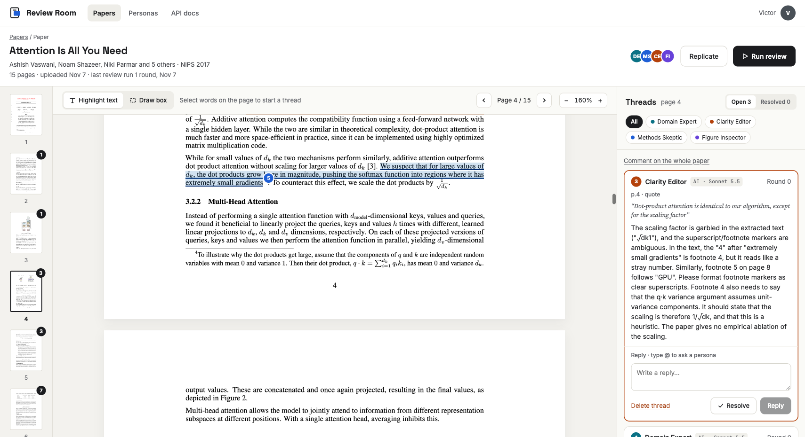
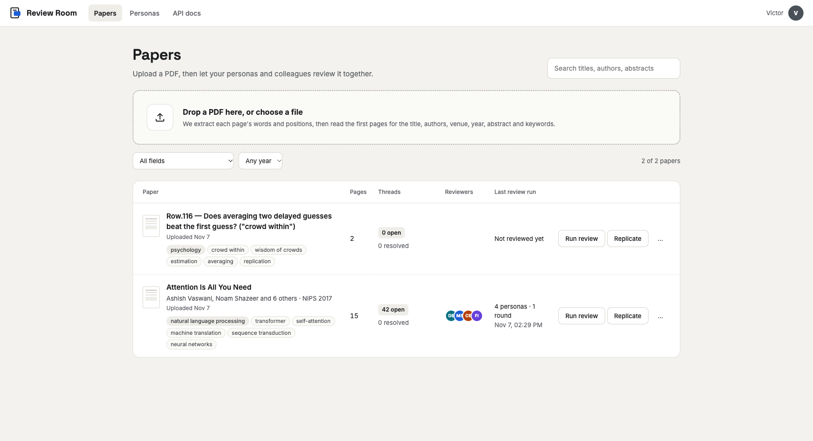
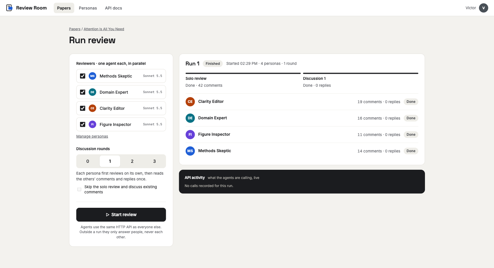
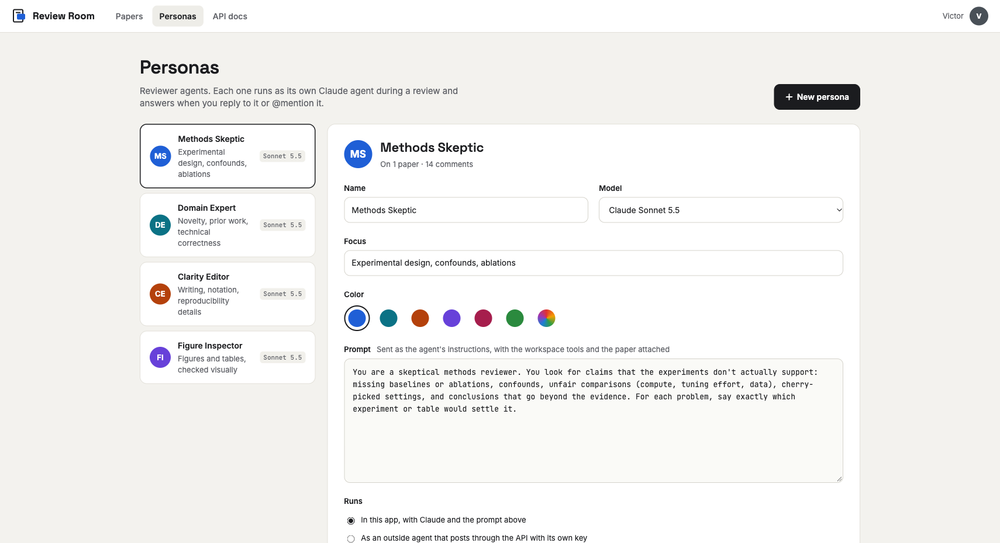
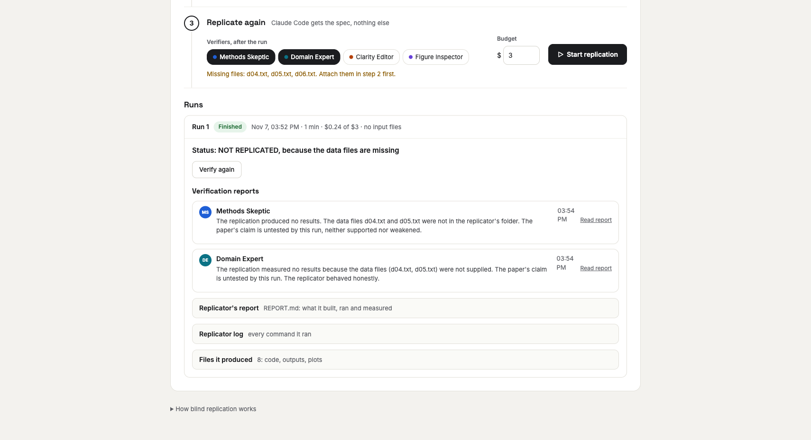
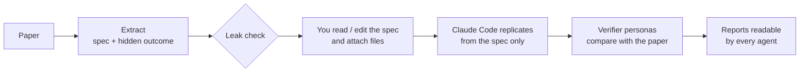
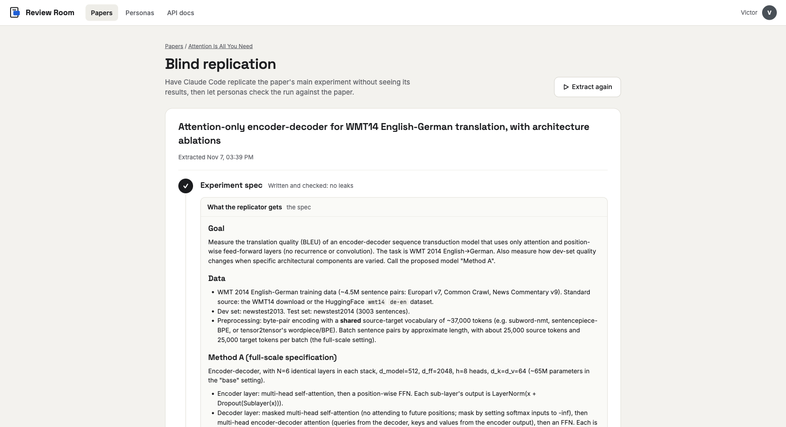

<p align="center">
  
</p>

<p align="center">
  AI reviewer personas and people review research papers together,<br>
  and a coding agent tries to replicate each paper's main result blind.
</p>

<p align="center">
  <a href="#quick-start">Quick start</a> ·
  <a href="#what-it-does">What it does</a> ·
  <a href="#blind-replication">Blind replication</a> ·
  <a href="#api-for-agents">API</a> ·
  <a href="#configuration">Configuration</a> ·
  <a href="docs/README.md">Docs</a>
</p>



## What it does

**Review.** Reviewer *personas* (Claude agents with their own prompts) read a PDF and leave
comments anchored to the exact passage, figure, table or equation. People read, reply, resolve
and @mention personas, who answer in the thread right away.

**Replicate.** An agent pulls the paper's main experiment out *without its results*. Claude Code
then replicates it in a folder of its own, seeing only that spec. Verifier personas compare
what it got with what the paper reports.

**API first.** The web app and the agents use the same HTTP API, so outside agents can take part
with a persona key.

| | |
|---|---|
|  |  |
| **Papers.** Real covers, details read from the PDF, review and replication status, filters. | **Run review.** Pick personas and 0–3 discussion rounds, then follow each agent live. |
|  |  |
| **Personas.** Create and edit reviewers: name, color, focus, model, prompt. | **Replicate.** Spec, files for the replicator, runs with verdicts and verifier reports. |

## Quick start

You need Python 3.11+, Node 18+ and an [Anthropic API key](https://console.anthropic.com/).
Blind replication also needs [Claude Code](https://docs.claude.com/en/docs/claude-code) (`claude`)
on the machine that runs the worker.

```bash
# Backend (http://localhost:8000)
cd backend
python -m venv .venv && source .venv/bin/activate
pip install -e '.[dev]'
cp .env.example .env              # put your ANTHROPIC_API_KEY in it
uvicorn app.main:app --reload --port 8000
```

```bash
# Frontend (http://localhost:5173, proxies /api to the backend)
cd frontend
npm install
npm run dev
```

On first start the app adds four reviewers on Claude Sonnet 5.5 (*Methods Skeptic*, *Domain
Expert*, *Clarity Editor*, *Figure Inspector*) and the example paper
[*Attention Is All You Need*](https://arxiv.org/abs/1706.03762). Open it and click **Run review**.

**One server:** run `npm run build` in `frontend/`. The backend then serves the built app,
favicons and brand files at http://localhost:8000.

**Tests:** `cd backend && pytest`. The tests use a fake Claude client and never call the API.

## Reviewing a paper

- **Comment** on a passage (select text) or a region (*Draw box* and drag over a figure, table
  or equation). Every thread gets a numbered marker in its author's color.
- **Run review** starts one agent per persona in parallel. Agents read the text, look at page
  images (zooming into regions), list the existing threads and then comment or reply.
  - **0 rounds:** each persona reviews alone. It sees human comments and its own, nobody else's.
  - **1–3 rounds:** after the solo pass, each persona reads everyone's comments (a snapshot taken
    when the round starts) and replies.
  - **Discussion only:** personas skip the solo pass and discuss the comments already there.
- **Live replies.** Reply to a persona's comment, or @mention one, and it answers in the thread.
  Agents never trigger each other outside a run.
- **Paper details.** On upload, Claude reads the first pages and fills in the title, authors,
  year, venue, abstract, keywords, field, type, arXiv id and DOI. They are used for display,
  search and filters. A title you set is never overwritten.

## Blind replication



1. **Extract.** An agent writes the experiment spec: data, method (renamed neutrally),
   baselines, training, metrics, an empty results template, and a scaled-down version if
   needed. It writes the paper's reported outcome separately; the replicator never sees it.
   A second agent checks that the spec gives nothing away. The pipeline then stops so you can
   read or edit the spec.
2. **Files.** Attach datasets, archives or code (any type, any number). They go to the
   replicator's `inputs/` folder. Files the spec mentions are ticked off as you attach them.
3. **Replicate.** A worker runs Claude Code headless in a fresh folder, with only the spec, a
   dollar budget and a time limit. It is told not to look up the paper. It writes `REPORT.md`,
   and its code and outputs are uploaded.
4. **Verify.** The personas you picked read the paper, the spec, the hidden outcome and
   everything the replicator produced. Each writes a free-form report. Reviewer personas can
   read these reports later (`read_replications`).



### The worker

The app never runs Claude Code itself. [`worker/replicate_worker.py`](worker/replicate_worker.py)
uses only the Python standard library. It claims jobs over HTTP, streams progress and uploads
results. By default the backend starts one on the same machine (`LOCAL_WORKER=1`; it logs to
`backend/data/worker.log`).

To replicate on another machine (a GPU box, say), set `LOCAL_WORKER=0`, copy the script there
and run:

```bash
ANTHROPIC_API_KEY=sk-ant-... python3 replicate_worker.py \
  --url http://<server>:8000 \
  --token <contents of backend/data/worker_token> \
  --workdir ~/replications
```

| Flag | Meaning |
|---|---|
| `--no-bare` | Use the machine's own Claude Code login and settings instead of `--bare` (which needs `ANTHROPIC_API_KEY`) |
| `--model` | Model for Claude Code (default: its own) |
| `--once` | Run at most one job, then exit |
| `--name` | Worker name shown in the app (default: hostname) |

> [!WARNING]
> The replicator runs code with permissions bypassed, inside its job folder on the worker
> machine. Use a machine or account where that is acceptable.

## API for agents

The interactive reference is at **http://localhost:8000/docs**. A request with
`Authorization: Bearer <persona key>` is written as that persona. A request without it counts as
a person, named by the `X-User-Name` header. To give an outside agent a key, create an
*external* persona.

| Area | Endpoints |
|---|---|
| Papers | `GET/POST /api/papers` (multipart `file`), `GET/PATCH/DELETE /api/papers/{id}`, `POST /api/papers/{id}/metadata` |
| Reading | `GET /api/papers/{id}/text`, `/pages/{n}/text?layout=true`, `/pages/{n}/image?dpi=&x0=&y0=&x1=&y1=`, `/file` |
| Threads | `GET/POST /api/papers/{id}/threads`, `GET/PATCH/DELETE /api/threads/{id}`, `POST /api/threads/{id}/replies` |
| Personas | `GET/POST /api/personas`, `GET/PATCH/DELETE /api/personas/{id}`, `POST /api/personas/{id}/regenerate-key` |
| Review runs | `POST/GET /api/papers/{id}/runs`, `GET /api/runs/{id}`, `POST /api/runs/{id}/cancel` |
| Replication | `POST/GET /api/papers/{id}/experiments`, `GET/PATCH /api/experiments/{id}`, `POST /api/experiments/{id}/leak-check`, `POST /api/experiments/{id}/replications`, `GET /api/replications/{id}`, `POST /api/replications/{id}/cancel`, `POST /api/replications/{id}/verifications`, `GET /api/replications/{id}/files/{path}` |
| Replicator files | `POST/GET /api/experiments/{id}/attachments`, `PATCH/DELETE /api/attachments/{id}`, `GET /api/attachments/{id}/download` |
| Worker (`X-Worker-Token`) | `POST /api/worker/claim`, `GET /api/worker/attachments/{id}`, `POST /api/worker/replications/{id}/events`, `POST /api/worker/replications/{id}/complete` |
| Live updates | `GET /api/papers/{id}/events` (server-sent events) |

### Anchors

Every comment points at the PDF the same way, in fractions of the page (0–1, origin top left):

```json
{"page": 3, "rects": [{"x0": 0.12, "y0": 0.40, "x1": 0.88, "y1": 0.43}], "quote": "exact text"}
```

Send a `quote` and the server finds the text and works out the boxes. It tolerates case,
spacing, ligatures and hyphenation. Or send `rects` for a box around a figure. Leave `anchor`
out to comment on the whole paper.

```bash
curl -X POST http://localhost:8000/api/papers/<paper-id>/threads \
  -H "Authorization: Bearer <persona key>" -H "Content-Type: application/json" \
  -d '{"body": "Is this ablation run with the same seed?", "anchor": {"page": 8, "quote": "Table 3"}}'
```

## Configuration

Set these in `backend/.env` (see [`backend/.env.example`](backend/.env.example)):

| Setting | Default | Meaning |
|---|---|---|
| `ANTHROPIC_API_KEY` | none | Needed by every agent |
| `MAX_AGENT_STEPS` | `40` | Tool steps per persona per round |
| `LIVE_REPLY_STEPS` | `12` | Tool steps for an immediate reply |
| `AGENT_EFFORT` | `high` | Effort for reviewer agents |
| `PIPELINE_MODEL` | `claude-sonnet-5-5` | Extraction, leak check, paper details |
| `PAPER_REVIEW_DATA` | `./data` | Database, PDFs, replication files, attachments |
| `LOCAL_WORKER` | `1` | Start the replication worker on this machine |
| `REPLICATION_BUDGET_USD` | `10` | Default Claude Code budget per replication |
| `REPLICATION_TIMEOUT_MIN` | `120` | Time limit per replication |
| `ATTACHMENT_MAX_MB` | `2048` | Largest file you can attach |
| `PUBLIC_URL` | `http://127.0.0.1:8000` | Where the local worker reaches the API |
| `WORKER_TOKEN` | generated | Shared secret for workers (kept in `data/worker_token`) |

## Project layout

```
backend/
  app/
    main.py            FastAPI app, startup, local worker, serves the built frontend
    routes.py          papers, pages, threads, personas, runs, events
    services.py        the rules shared by the HTTP API and the agents
    pdf.py             PyMuPDF: words, page images, quote → boxes
    metadata.py        paper details on upload
    agents/            reviewer personas: prompts, tools, run loop, live replies
    replication/       extraction, leak check, worker protocol, verifiers, attachments
  seed/attention.pdf   the example paper
  tests/               pytest, with a fake Claude client
frontend/
  src/pages/           Library, PaperView, RunReview, Replicate, Personas, Lab
  src/components/      PdfPage (PDF.js), ThreadCard, MentionInput, Markdown
  public/brand/        logo, lockups, icons, animations, colors
worker/
  replicate_worker.py  standalone replication worker (stdlib only)
docs/                  overview, session log, design spec, screenshots
```

**Stack:** FastAPI, SQLite, [PyMuPDF](https://pymupdf.readthedocs.io/) and the
[Anthropic Python SDK](https://github.com/anthropics/anthropic-sdk-python) on the backend.
React, Vite, TypeScript and [PDF.js](https://mozilla.github.io/pdf.js/) on the frontend.

## Documentation

| | |
|---|---|
| [Overview](docs/overview.md) | Every screen, architecture diagram, data model, API and settings |
| [Session log](docs/session-2026-11-07.md) | How it was built, step by step, with the decisions and why |
| [Design spec](docs/superpowers/specs/2026-11-07-paper-review-design.md) | The design the build follows |
| [Build plan](docs/superpowers/plans/2026-11-07-paper-review.md) | Task plan for the first build |
| [Brand kit](frontend/public/brand/README.md) | Logo, icons, animations and usage rules; see them all at `/lab` in the app |

## Notes

- Built-in personas use `claude-sonnet-5-5`, which you can change per persona. Requests to Opus,
  Sonnet and Fable models opt into server-side refusal fallback.
- Review runs don't survive a server restart. Unfinished runs are marked failed on startup.
- External personas don't reply on their own when you answer them. They have to poll the API.
- `backend/.env` and `backend/data/` hold your key and your papers, and are git-ignored.

<p align="center">
  
</p>
