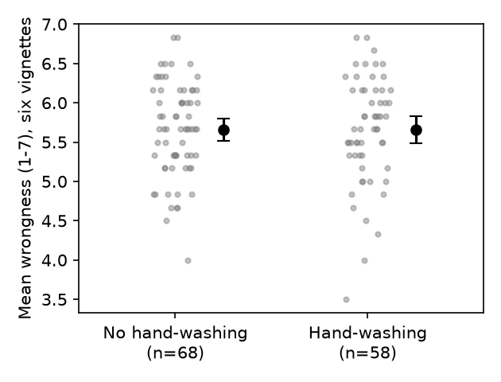

# S01: Does hand-washing after a disgusting clip make moral judgments less severe?

**Question.** After everyone watches the same disgust-inducing film clip, do participants asked to wash their hands rate six morally questionable acts as less wrong (lower mean wrongness, 1–7) than participants not asked to wash?

**Data.** Replication data, `d12.sav` (second study; 132 participants, individual lab sessions, random assignment). Group: `Condition` (0 = no hand-washing, 1 = hand-washing, per the card's codebook; the file carries no value labels). DV: `mean_vignettes`, the mean of the six wrongness items (Dog, Trolley, Wallet, Plane, Resume, Kitten); I verified it equals the recomputed item mean for every row.

**Exclusions (pre-registered, fixed before analysis).** "All of my answers are made up" = yes (`Madeup_dummy` = 1, n = 4) or experimenter error (`Exp_Error` = 1, n = 3); one participant had both, so 6 were excluded (1 control, 5 hand-washing). Suspicion ratings were not used in the key test. **N after exclusions = 126** (68 no-wash, 58 wash).

**Primary test (named in the log before the data were opened).** One-way between-subjects ANOVA of `mean_vignettes` by `Condition` (equivalent to a Student t-test, equal variances), two-sided; effect size Cohen's d with pooled SD, hand-washing minus no hand-washing, 95% CI from the noncentral t. The claim was to count as holding if d < 0 and p < .05.

## Result

| Group | n | Mean | SD |
|---|---|---|---|
| No hand-washing | 68 | 5.654 | 0.593 |
| Hand-washing | 58 | 5.658 | 0.680 |

**F(1, 124) = 0.001, p = .97** (t(124) = 0.03). Difference (wash − no wash) = +0.004 scale points. **Cohen's d = 0.01, 95% CI [−0.35, 0.36].** The point estimate is zero and in the wrong direction by a hair; the interval rules out an effect larger than about d = −0.35 in the predicted direction.

**Robustness (not the basis of the conclusion).** Welch t = 0.03, p = .97; Mann–Whitney p = .77; one-sided t (wash < no wash) p = .51. With no exclusions (N = 132): d = −0.05 [−0.39, 0.30], p = .80. Also dropping anyone with any suspicion rating (`Final_Rating` = 0 only, N = 84): d = −0.08 [−0.51, 0.35], p = .72. No single vignette differed between groups (all |t(124)| ≤ 1.10, all p ≥ .27; three differences positive, three negative). Variances were similar (Levene p = .51). Self-rated disgust after the clip did not differ by condition (18.7 vs 18.5 on the file's summed scale), as expected since it was a common clip.

**Limits.** The test assumes the codebook's 0/1 coding of `Condition`; the result is a null either way, so a reversed coding would not change the conclusion. N = 126 exceeds the planned 104, but the CI still allows small effects (|d| < 0.35) in either direction.

## Conclusion

**The claim does not hold on this data:** hand-washing after the disgust clip did not lower moral wrongness ratings (F(1, 124) = 0.001, p = .97, d = 0.01, 95% CI [−0.35, 0.36]).

*Files: `analysis.py` (produces every number here), `analysis.out`, `fig1.png`, `log.md`.*
