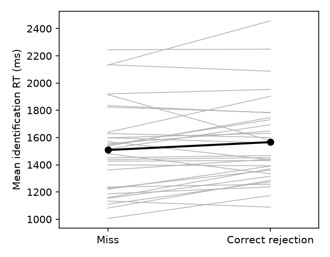

# S02 — Are missed old words identified faster than correctly rejected new words?

**Question.** Among test words a participant judges "new", are words that were in fact studied (misses) identified faster than words never studied (correct rejections, CR)? Prediction: mean identification RT(CR) > RT(miss).

**Design and data.** Single-group, within-subjects replication with German native speakers (n = 32). Study phase of 70 identification trials; test phase of 100 identification trials (50 old, 50 new), each followed by an old/new judgement. Identification RT is the time from onset of the progressively unmasked word to the participant's click. The test was run on the shared per-participant aggregate file (`d07.dat`: mean test RT per cell, all classified test trials, no identification filter). I confirmed that the four cell means in that file are reproduced exactly from the trial-level file (`d14.sav`), which also fixed the cell coding.

**Sample after exclusions.** 32 participants, none excluded; every participant had at least one miss (2 to about 20 miss trials per person, median 8) and at least 26 CRs. Three test trials with no response (no old/new rating) are unclassified and drop out of all cells.

**Primary test (fixed in advance).** Two-sided paired t-test, `meanRT_cr` vs `meanRT_miss`; dz = t/√n with a noncentral-t 95% interval. The claim holds if CR − miss > 0 with p < .05.

| | Mean RT (ms) | SD |
|---|---|---|
| Correct rejections | 1566.0 | 314.0 |
| Misses | 1508.1 | 325.9 |
| Difference (CR − miss) | **57.9**, 95% CI [8.7, 107.1] | 136.6 |

**Result: t(31) = 2.40, p = .023, dz = 0.42, 95% CI [0.06, 0.78].** 22 of 32 participants were slower on CRs than on misses.

**Robustness (not the basis of the conclusion).** Wilcoxon signed-rank on the same pairs: p = .022. Applying the protocol's filter at trial level (drop test trials where the word was misidentified, 42 trials, and old words misidentified at study, 29 test trials) leaves one participant with no misses, so n = 31: t(30) = 2.43, p = .022, dz = 0.44 [0.06, 0.80]. Also dropping 4 no-response RTs: t(30) = 2.41, p = .022. Per-participant medians in place of means: t(31) = 2.65, p = .013, dz = 0.47 [0.10, 0.83]. The direction and size of the effect (about 57–59 ms) are the same across all versions.

**Caveats.** Miss cells are small (median 8 trials), so the per-person miss means are noisy, and the lower bound of the interval for dz is near zero (0.06): the data support a difference in the predicted direction but leave its size uncertain, from very small to large.

**Conclusion.** The claim holds on this data: studied words judged "new" were identified on average 58 ms faster than unstudied words judged "new" (t(31) = 2.40, p = .023, dz = 0.42).

*Files: `analysis.py` (produces every number here), `analysis.out`, `log.md`.*
