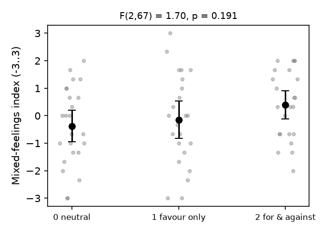

# S03: Does listing only reasons in favour of one's advice reduce mixed feelings about an unrelated issue?

**Question.** Do people who list only reasons in favour of a piece of advice they have chosen (condition 1) report less mixed feelings about an unrelated social issue (making the convicted sex-offender list public) than people who list reasons for and against (condition 2), with a neutral control (condition 0)? The key test, fixed in advance, is the omnibus difference among the three conditions; the claim holds if that test is significant at p < .05 with condition 1 below condition 2.

**Data and sample.** Replication analysis file `d05.txt`: 89 college students. 19 were excluded under the pre-specified rule (reported experience with sexual offenders or the offender list; `Include` = 0, which matches `SexOffender` = "Yes" exactly). No other exclusions. **n = 70** (neutral 24, favour-only 23, for-and-against 23). One participant answered two of the three items and was scored on those two.

**Measure.** Mixed-feelings index = mean of StrongMixed, -NotTorn and (Indecisive - 4), range -3..3, higher = more mixed feelings. Cronbach's alpha = .76.

**Test.** One-way between-subjects ANOVA of the index on Condition; eta^2 = SS_condition / (SS_condition + SS_error), 95% CI by noncentral-F inversion.

| Condition | n | Mean | SD |
|---|---|---|---|
| 0 neutral | 24 | -0.38 | 1.44 |
| 1 reasons in favour only | 23 | -0.14 | 1.66 |
| 2 reasons for and against | 23 | 0.39 | 1.25 |

**Result.** **F(2, 67) = 1.70, p = .191, eta^2 = .048, 95% CI [.000, .158].** The means are ordered 0 < 1 < 2, so condition 1 is lower than condition 2 as predicted, but the differences are small relative to the spread and the omnibus test is not significant.

**Checks (not decisive).** Assumptions looked acceptable (Levene p = .46; Shapiro-Wilk on residuals p = .31). Welch ANOVA F(2, 44.1) = 2.01, p = .147; Kruskal-Wallis H(2) = 3.38, p = .185. Condition 1 vs 2: t(44) = -1.24, p = .222, Cohen's d = 0.37, mean difference -0.54, 95% CI [-1.41, 0.34]. Tukey: 0 vs 2 p = .177, 0 vs 1 p = .851. The second file (`d06.tsv`, 97 rows, filtered to `SexOffender` = "No", n = 68) gives F(2, 65) = 1.91, p = .156, with the same ordering of means.

**Limitations.** About 23 per group gives low power for a medium effect (power for the 1-vs-2 contrast at the observed d was about .23), so the CI for eta^2 runs up to .16. A non-significant result here does not show that there is no effect. It shows that this sample does not detect one.

**Conclusion.** The claim does not hold on this data: the three conditions do not differ significantly in mixed feelings (F(2, 67) = 1.70, p = .19). Condition 1 is lower than condition 2, the predicted direction, but not reliably so.
