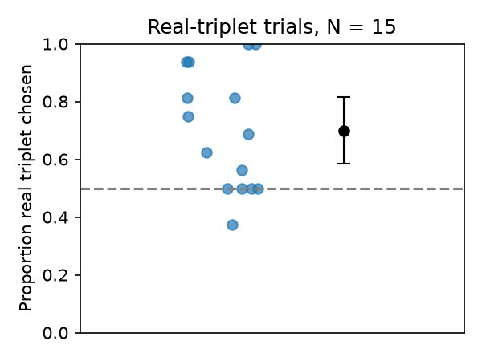

# S04 — Statistical learning of colour triplets: report

**Question.** After watching a stream of coloured nonsense shapes in which colours recur in fixed temporal triplets, do people judge colour-only triplets that occurred in the stream as more familiar than foil triplets, above chance (50%)?

**Data and sample.** 15 participant files (MATLAB), each with 32 two-alternative familiarity trials: 16 "real" (real colour triplet vs foil) and 16 "pseudo" (pseudo-triplet vs foil). Following the design, pseudo trials are discarded. No participants or trials were excluded (N = 15; 0 excluded): all files were complete, and the recorded `correct` field agreed with the response and the interval order on all 480 trials.

**Measure.** Per participant, the proportion of the 16 real trials on which the real triplet was chosen.

**Primary test (named before analysis).** Two-sided one-sample t-test of the 15 proportions against 0.5; effect size d = t/√n, 95% CI by noncentral-t inversion. The claim holds if the mean is above 0.5 with p < .05.

## Result

| | value |
|---|---|
| Mean proportion correct (real trials) | 0.700 (SD 0.209), 95% CI [0.584, 0.816] |
| t-test vs 0.5 | **t(14) = 3.71, p = .0023** |
| Effect size | **d = 0.96, 95% CI [0.33, 1.56]** |
| Participants above / at / below 0.5 | 10 / 4 / 1 |

**Robustness (not primary).** Wilcoxon signed-rank vs 0.5: p = .007 (4 ties at 0.5 dropped). Pooled across trials, 168/240 = 0.70 choices of the real triplet (binomial p < .0001; ignores clustering by participant). Descriptively, pseudo-triplet trials were also chosen above chance (mean 0.62, t(14) = 2.36, p = .033); these trials are outside the claim and were not used in the conclusion.

**Limits.** Small sample (n = 15), so the effect-size interval is wide (d from 0.33 to 1.56); the lower bound is still clearly above zero. The test cannot separate implicit learning from explicit noticing, since participants who reported noticing the triplets were kept by design.

**Conclusion.** The claim holds on this data: participants chose the real colour triplet over the foil on 70% of real trials, reliably above chance (t(14) = 3.71, p = .002, d = 0.96).
