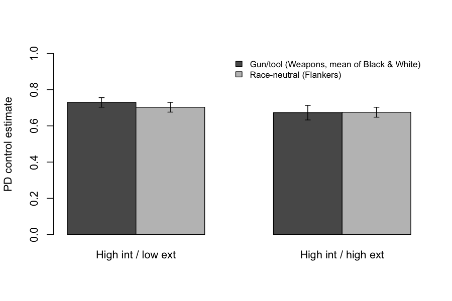

# S06: Is the control advantage of high-internal/low-external participants specific to race?

**Question.** Among people high in internal motivation to respond without prejudice, do those low in external motivation (HI/LE) show better response control than those high in it (HI/HE) specifically on the race-primed gun/tool task (Weapons) rather than on a race-neutral flanker task? Tested as the Group × Task interaction on the process-dissociation (PD) control estimate.

**Data and sample.** Replication's derived PD file (`d11.csv`): three rows per participant (Weapons-Black, Weapons-White, Flankers). N = 75 (46 HI/LE, 29 HI/HE), 225 rows, no missing values. **No exclusions** (as pre-specified on the card); 0 participants removed.

**Pre-specified primary test.** `aov(PD ~ Group * Task + Error(ID/Task))` in R, both Weapons rows kept; Group × Task F from the ID:Task stratum; partial η² = SS_int / (SS_int + SS_res). Criterion for "holds": p < .05 with the group advantage (HI/LE − HI/HE) larger on Weapons than on Flankers.

**Descriptives (mean PD, SD).**

| Group | Weapons-Black | Weapons-White | Weapons (mean) | Flankers |
|---|---|---|---|---|
| HI/LE (n = 46) | .743 (.180) | .717 (.190) | .730 | .703 (.182) |
| HI/HE (n = 29) | .702 (.214) | .644 (.232) | .673 | .675 (.148) |
| Difference | .040 | .073 | .057 | .028 |

**Result.** Group × Task: **F(1, 73) = 0.43, p = .513, partial η² = .006 (90% CI [.000, .065]; 95% CI [.000, .083])**. The direction is as predicted (group difference .057 on Weapons vs .028 on Flankers; interaction contrast .029, 95% CI [−.059, .118] on the PD scale), but it is small and far from significant. Neither simple group effect is significant (Weapons: Welch t(51.3) = 1.18, p = .244; Flankers: t(68.4) = 0.72, p = .476), nor is the Group main effect (F(1, 73) = 1.45, p = .232).

**Checks.** The 2 × 2 mixed ANOVA on the per-participant Weapons mean gives the identical interaction (F(1, 73) = 0.43, p = .513), as does the pingouin cross-check in Python; a Wilcoxon test on the Weapons−Flankers difference score gives p = .476. On the Weapons task, the HI/LE advantage was, if anything, larger on White-face trials (.073) than on Black-face trials (.040), which does not fit a race-bias-specific account.

**Limitations.** Unequal and modest groups (46/29); with this N the 95% CI on partial η² still includes effects up to about .08, so a small-to-moderate interaction cannot be ruled out.

**Conclusion.** The claim does not hold on this data: the HI/LE control advantage is not detectably larger on the race-primed gun/tool task than on the race-neutral task (F(1, 73) = 0.43, p = .51, partial η² = .006).

*Files:* `analysis.py` (runs `analysis.R`), `analysis.out`, `log.md`.
