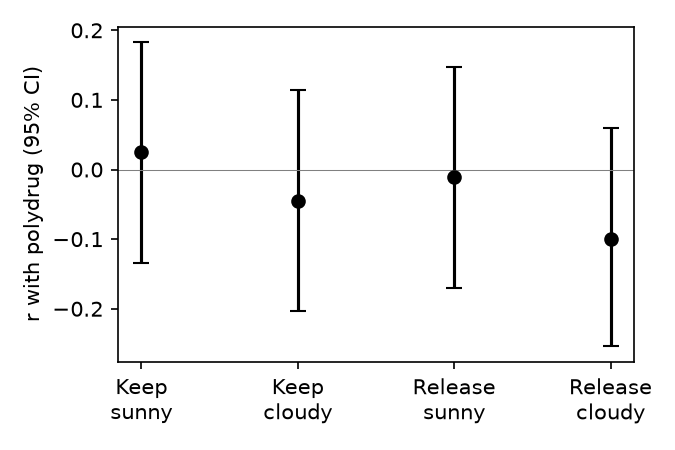

# S07: Does the angling game predict drug use better in sunny than cloudy conditions?

**Question.** In a sequential risk-taking (fishing) game, is the correlation between risk taking and real-world drug use larger when the pond's contents are visible (sunny) than when they are hidden (cloudy)? Predicted sign of the contrast sunny minus cloudy: positive.

**Data and sample.** Replication raw data: trial file (20,722 rounds), item-level drug questionnaire, and the cleaned per-participant file. I recomputed every score from the raw files; they match the cleaned file exactly.

- 161 participants have game data in all four conditions (Keep/Release x Sunny/Cloudy). 150 trial rows with no participant id were dropped as unattributable (no other duplicate rows exist).
- 8 participants have no drug-use score (questionnaire not completed) and were dropped.
- **N = 153** with all five values.

**Measures.** Casting score per condition (KS, KC, RS, RC): mean number of casts on rounds the participant stopped voluntarily (blue-fish rounds excluded; all rounds, including practice, as in the cleaning script). Polydrug: sum over 11 drug classes of (frequency rank at time of heaviest use − 1); mean 6.93, SD 4.39, range 0–25.

**Primary test (named in advance).** Pearson r of polydrug with each casting score, Fisher z, Meng–Rosenthal–Rubin (1992) contrast with weights (+1, −1, +1, −1) on (KS, KC, RS, RC), r_x = median inter-correlation of the four casting scores (0.389). Claim holds if Z > 0 and two-sided p < .05.

| Condition | r with polydrug | p |
|---|---|---|
| Keep, sunny | 0.026 | .75 |
| Keep, cloudy | −0.046 | .57 |
| Release, sunny | −0.011 | .89 |
| Release, cloudy | −0.099 | .22 |

**Result.** Z = 1.25, two-sided p = .21, N = 153 (Z is referred to the standard normal; no df). Effect size: mean Fisher z sunny minus mean z cloudy = 0.080, 95% bootstrap CI [−0.076, 0.229] (5,000 participant resamples); r_contrast = Z/√N = 0.10. The direction is as predicted (sunny correlations slightly higher in both release rules), but none of the four correlations differs from zero (all |r| < .10). So there is little game–drug association to strengthen or weaken in the first place.

**Robustness (not the basis of the conclusion).** Spearman correlations: Z = 0.76, p = .45. Log(1 + polydrug): Z = 0.81, p = .42. Practice rounds removed: Z = 1.00, p = .32. None reaches significance.

**Conclusion.** The claim does not hold on this data: the sunny-minus-cloudy contrast is in the predicted direction but small and not significant (Z = 1.25, p = .21), and the game scores barely correlate with drug use in any condition.
