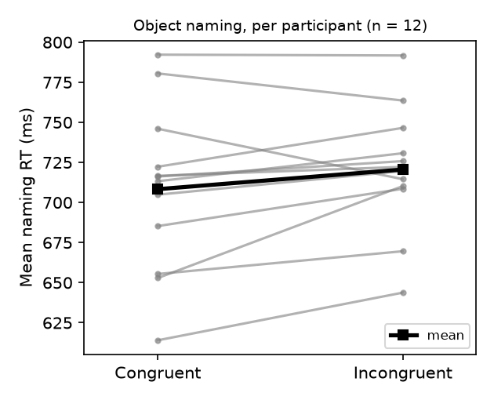

# S10: Does a colour word's onset speed naming of the object after it?

**Question.** When English speakers name the object in a coloured line drawing, are they faster when the object's name shares its onset with the colour's name (congruent, e.g. a *green goose*) than when it does not (incongruent)? Prediction tested: congruent mean RT < incongruent mean RT in the object-naming group.

**Data and design.** Replication data, trial level (`d06.sav`): 24 participants, 80 experimental items each (40 congruent, 40 incongruent pairings; fillers are not in the file). Task between subjects: 12 object-naming, 12 colour-naming. Only the 12 object-naming participants enter the primary test.

**Exclusions (fixed before analysis, as specified in the study design).** Of 960 object-naming trials: 47 error trials dropped (4.9%; all negative or placeholder RTs were among these), then 14 trials more than 3 SD from that participant's error-free mean dropped (1.5%); 899 trials kept. No participant excluded: **n = 12**. The per-participant means I re-derived match the supplied condition means (`d02.sav`) exactly (max difference 0.0 ms).

**Primary test.** Two-sided paired t-test on per-participant mean RT, congruent vs incongruent (by subjects, F1); dz = t/√n with a noncentral-t 95% CI.

| | Congruent | Incongruent |
|---|---|---|
| Mean RT (SD), ms | 708.3 (51.6) | 720.6 (38.7) |

Difference (C − I) = **−12.3 ms, 95% CI [−26.6, 2.1]**; 9 of 12 participants faster on congruent trials.
**t(11) = −1.88, p = .087; dz = −0.54, 95% CI [−1.14, 0.08].**

**Checks (not the basis of the conclusion).**

- Wilcoxon signed-rank on the same means: W = 18, p = .110.
- Errors dropped but no SD trim: −13.6 ms, t(11) = −2.20, p = .050. With a 2.5 SD trim: −12.9 ms, t(11) = −2.13, p = .057.
- Colour-naming group (claim predicts no effect): −18.3 ms, t(11) = −1.55, p = .149. The congruency effect does not differ between tasks: t(22) = 0.45, p = .66 on the C − I differences.

**Interpretation.** The difference is in the predicted direction and of moderate size, but the primary test does not reach p < .05 and the CI for the difference includes zero. Exclusion variants hover at p ≈ .05 on either side, so the result is fragile, not clearly null. The colour-naming group shows an effect of similar size, which does not fit the claimed asymmetry (an effect for object naming only), though that group was not tested by design. With n = 12 the test has little power for an effect of this size.

**Conclusion.** The claim does not hold on this data: object naming was 12 ms faster for onset-congruent colour-object pairs, but not significantly so (t(11) = −1.88, p = .087).
