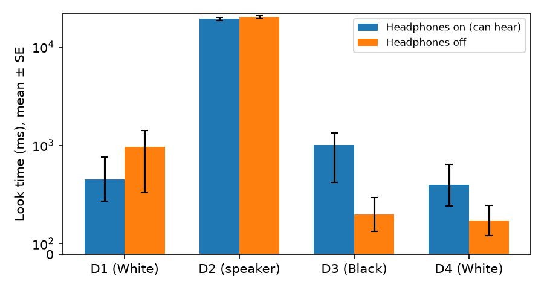

# S11: Do bystanders look longer at the Black discussant when he can hear a potentially offensive remark?

**Question.** When a White man criticises affirmative action, do observers look longer at the Black discussant when he can hear the remark (headphones on) than when he cannot (headphones off)? The claim is tested as the Condition × Discussant interaction on look time, with the condition difference expected to sit on discussant 3 (the Black man).

**Data and sample.** The replication site's long-format file (`d02.txt`): 120 rows = 4 discussants × 30 participants, subject identified by row position within each block. Checks: no missing values; each participant's condition code is identical across the four blocks; 15 participants per condition (Condi 4 = headphones on, 15; Condi 2 = headphones off, 15). The card's exclusions (dark-skinned participants, poor comprehension, eye-tracking failures) were applied before the file; I excluded no one further. **N = 30 after exclusions (0 excluded here).** The raw eye-tracking archive (`d04.zip`) was not needed.

**Test (fixed before analysis).** Mixed-design ANOVA: Condition (between, 2) × Discussant (within, 4), DV look time (ms) during the remark. Primary statistic: Condition × Discussant F with Greenhouse-Geisser correction; partial η² = SS_int / (SS_int + SS_error), with a 90% CI by noncentral-F inversion. The claim holds if the interaction is significant (α = .05) with the condition difference concentrated on discussant 3 in the predicted direction (on > off).

**Descriptives.** Mean look time, ms (SD):

| Discussant | Headphones on (can hear) | Headphones off |
|---|---|---|
| 1 (White) | 689 (783) | 986 (1627) |
| 2 (speaker) | 19280 (2386) | 20252 (2132) |
| 3 (Black) | 1003 (1329) | 367 (603) |
| 4 (White) | 636 (731) | 310 (536) |

**Result.** Sphericity was violated (Mauchly W = 0.12, χ²(5) = 56.3, p < .001; GG ε = 0.49). The **Condition × Discussant interaction was not significant: F(1.48, 41.46) = 1.40, p = .254 (GG), partial η² = .048, 90% CI [.000, .111]**. (Uncorrected F(3, 84) = 1.40, p = .248.) Main effect of Discussant: F(1.48, 41.46) = 1008, p < .001 (nearly all looking is at the speaker); main effect of Condition: F(1, 28) = 2.25, p = .145. Manual computation and `pingouin.mixed_anova` agree.

**Secondary checks (not the basis of the conclusion).** At discussant 3 the difference is in the predicted direction (1003 vs 367 ms, +637 ms) but not significant (Welch t = 1.69, p = .107); discussant 4, a White man who also could not hear in the off condition, shows a similar on > off difference (+326 ms, p = .176), so the difference is not specific to the Black discussant. Excluding the speaker region, the interaction is F(2, 56) = 2.03, p = .155 (GG). On log(1 + ms), a transform I added after seeing the skewed, zero-heavy data, the interaction reaches F(3, 84) = 3.20, p = .035 (GG), η²p = .10; this is sensitive to the transform and not the pre-specified test.

**Conclusion.** On this replication sample (N = 30), the claim does not hold: the pre-specified Condition × Discussant interaction on look time is not significant (F(1.48, 41.46) = 1.40, p = .25, η²p = .05), although the means at the Black discussant go in the predicted direction.

*Limits:* small sample (15 per cell), heavily skewed look times with many zeros, and a test dominated by variance at the speaker's region; power to detect a moderate interaction is low.
