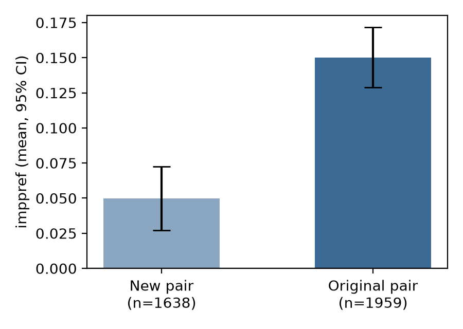

# S12: Does a response-speed preference transfer immediately to new group members?

**Question.** Right after learning about one mostly-positive and one mostly-negative individual from two fictional groups, is the response-speed (sorting-task) preference people show between two *new* members of those groups as large as the preference others show between the two *original* individuals? The claim predicts no difference between new-pair and original-pair raters.

**Data and sample.** Replication data `d07.csv`, 4,267 rows. Exclusions, applied in the stated order: missing self-reported preference, 322; missing sorting-task score, 285; more than 10% of trials under 300 ms, 1; not exactly 200 scored trials, 62. **N = 3,597** remain: 1,638 rated the new pair and 1,959 rated the original pair. No further rows had a missing condition or outcome.

**Test (fixed before analysis).** Two-sided Welch two-sample t-test of `imppref`, new-pair group vs original-pair group. Cohen's d uses the pooled SD. Before running it I set the decision rule: the claim holds only if the test is non-significant and the 95% CI of d lies inside ±0.2. It fails if p < .05.

**Result.**

| Group | n | mean imppref | SD | vs 0 |
|---|---|---|---|---|
| New pair | 1,638 | 0.050 | 0.470 | t = 4.29, p < .001 |
| Original pair | 1,959 | 0.150 | 0.481 | t = 13.81, p < .001 |

Welch **t(3511.1) = −6.31, p = 3.2 × 10⁻¹⁰**. Mean difference (new − original) = −0.100, 95% CI [−0.132, −0.069]. **Cohen's d = −0.21, 95% CI [−0.28, −0.15].** The preference for the new pair is about one third of the preference for the original pair. An equivalence test at ±0.2 d fails (TOST p = .63).

**Checks.** The Student t-test gives t(3595) = −6.30, p < .001, and the Mann–Whitney test gives p < .001. Both agree with the primary test. The new-pair preference is above zero, so some transfer does occur, but less than the full amount. On the companion self-report measure the gap is much larger: means 0.19 vs 1.09, Welch t = −22.8, p < .001.

The two groups are not balanced. The raw data have 2,208 original-pair and 1,946 new-pair rows, and the exclusions removed more new-pair raters (15.8% vs 11.3%). After exclusions the split differs from 50/50 (binomial p < .001). I cannot check from these data whether this affects the result. The difference is large and stable across tests, so the imbalance seems unlikely to reverse it.

**Conclusion.** The claim does not hold on this data: immediately after learning, the response-speed preference for the new group members is reliably smaller than the preference for the original individuals (d = −0.21), not equal to it.
