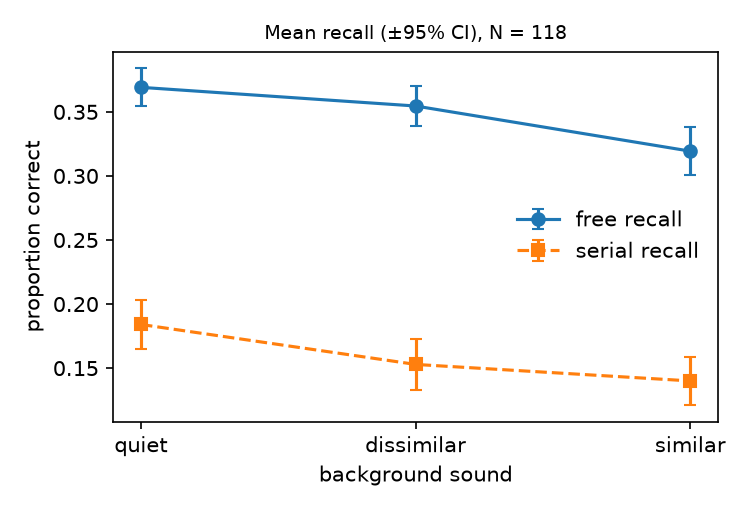

# S14 — Does rhyming irrelevant speech hurt free recall more than serial recall?

**Question.** Spoken to-be-ignored words that rhyme with a list of written to-be-remembered words should disrupt recall more than non-rhyming speech, and this extra disruption should be larger when recall is in any order (free) than when it must be in the presented order (serial). The claim is the sound × instruction interaction.

**Data and sample.** Replication file `d04.sav` (`d05.xlsx` is an identical copy, checked in the script). 118 participants, 59 free recall and 59 serial recall; no duplicate ids, no missing values, **0 excluded** (the file already holds only the analysed participants, as the protocol says). Measure: proportion of words correctly recalled per sound condition (quiet, dissimilar speech, similar speech); serial recall scored by strict position.

**Test (fixed before looking at the data).** 3 (sound, within) × 2 (instruction, between) mixed ANOVA, sphericity assumed. Key term: the sound × instruction interaction, F(2, 232), with partial η². The claim holds only if this term is significant at α = .05 and its pattern is the predicted one (dissimilar − similar larger under free recall).

| Instruction | Quiet | Dissimilar | Similar | Dissimilar − Similar |
|---|---|---|---|---|
| Free (n = 59) | .369 (.058) | .355 (.060) | .319 (.074) | .035 (.061) |
| Serial (n = 59) | .184 (.074) | .153 (.078) | .140 (.073) | .013 (.074) |

Means (SD) of proportion correct.

**Primary result.** Sound × instruction: **F(2, 232) = 1.63, p = .199, partial η² = .014, 90% CI [.000, .043]** (95% CI [.000, .052]). Mauchly's test gave no sign of non-sphericity (p = .78); the Greenhouse–Geisser p is the same (.199). An independent R `aov` reproduced the F exactly.

**Context (not the basis of the conclusion).** Main effect of sound: F(2, 232) = 26.60, p < .001, partial η² = .19; free recall is much higher than strict serial recall overall (F(1, 116) = 323.5). Similar vs dissimilar within groups: free t(58) = 4.42, p < .001, d_z = 0.58; serial t(58) = 1.35, p = .18, d_z = 0.18. The one-degree-of-freedom version of the prediction (difference score dissimilar − similar, free vs serial) is in the predicted direction but not significant: difference .022, 95% CI [−.002, .047], t(116) = 1.80, p = .075, d = 0.33. The general cost of speech relative to quiet is similar in both groups (.032 vs .038).

**Reading.** The pattern points the way the claim predicts: rhyming speech costs free recall clearly, serial recall only a little and not reliably. But the test the claim names, the interaction, is small and not significant, and its interval runs from zero to a small effect. The follow-up paired t-tests do match the claim's second reading (effect in free, none detected in serial), but a significant effect in one group and a non-significant one in the other is not evidence that the two differ, and the direct test of that difference (p = .075) does not reach .05.

**Conclusion.** The claim does not hold on this data: the sound × instruction interaction is not significant (F(2, 232) = 1.63, p = .199, partial η² = .014), although its direction is the predicted one.
