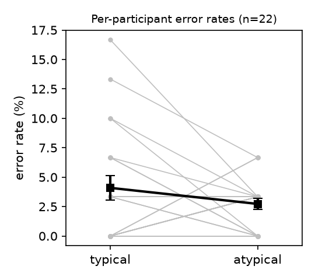

# S16 — Do location-typical cue words impair letter identification at that location? (error rates)

**Question.** After reading a word for an object with a typical location (e.g., *hat*: up; *boot*: down), do people make more errors identifying a briefly shown letter (X/O) when it appears at the word's typical location than at the opposite location?

**Data and sample.** Replication data (`d02.sav`): 22 participants × 60 experimental trials = 1,320 trials, 30 typical and 30 atypical trials per participant. No participants or trials excluded (as the card prescribes for error rates; no missing values; `resp_corr` agrees with the `Correct` string on 100% of trials). Total errors: 45 (27 typical, 18 atypical).

**Test (fixed in the log before analysis).** Per-participant error rate = proportion of trials with `resp_corr` = 0, per condition (`typisch` 1 = typical, 2 = atypical). One-way repeated-measures ANOVA by subjects (F1), typical vs atypical; partial η² = SS_location / (SS_location + SS_error), 95% CI by noncentral-F inversion. The claim holds if typical > atypical with p < .05.

**Result.**

| | Typical | Atypical |
|---|---|---|
| Mean error rate (SD) | 4.09% (4.82) | 2.73% (2.21) |

- **F(1, 21) = 1.45, p = .242, partial η² = .065, 95% CI [.00, .31].**
- Mean difference (typical − atypical) = 1.36 percentage points, 95% CI [−0.99, 3.72]; d_z = 0.26.
- 9 participants made more errors at the typical location, 7 fewer, 6 tied.
- Robustness (not primary): Wilcoxon signed-rank W = 44.5, p = .216; trial-level logistic GEE clustered by participant, OR = 1.52, p = .176. Same direction, also not significant.

**Interpretation.** The difference is in the predicted direction but small and not distinguishable from zero. Errors are rare (3.4% overall, at most 5 of 30 trials per cell), so the test has little resolution: the interval for the difference runs from about a 1-point advantage for typical to a 3.7-point disadvantage, and the η² interval includes both zero and sizeable effects. The data therefore do not support the claim, without ruling out a modest effect.

**Conclusion.** The claim does not hold on this data: participants did not make significantly more identification errors at the cue word's typical location than at the atypical location (F(1, 21) = 1.45, p = .24).
