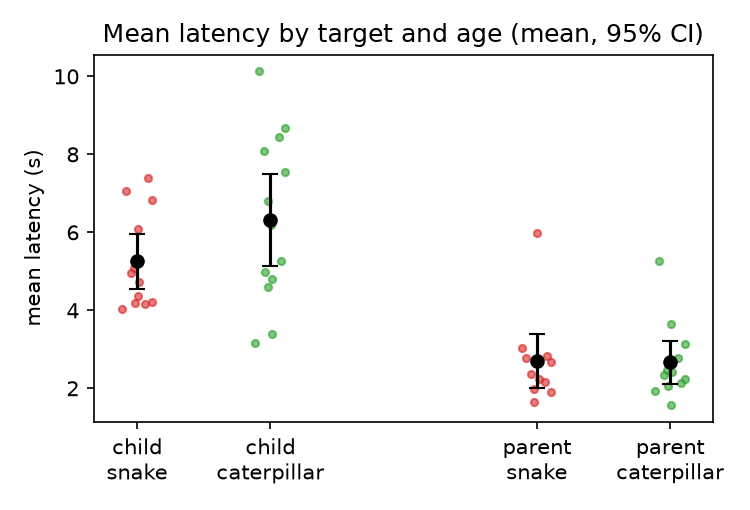

# S17: Is a snake found faster among caterpillars than a caterpillar among snakes?

**Question.** Do young children and adults touch a snake target among eight caterpillar distractors faster than a caterpillar target among eight snake distractors? The claim is a main effect of target stimulus, with lower mean latency for snake targets.

**Data and sample.** Replication analysis file `d05.sav`: one row per participant, 48 participants after the replication team's exclusions. Of 56 tested, 5 children were removed for touching the wrong picture on more than half the trials and 3 participants (2 children, 1 adult) for an average z score above 3. Cells: children, snake target 12, caterpillar 13; parents, snake 11, caterpillar 12. I applied no further exclusions. DV: `average`, each participant's mean latency (ms) over correct trials of 24.

**Test (fixed before analysis).** A two-way between-subjects ANOVA on `average` with target stimulus × age group, type-III sums of squares and sum-to-zero coding. The key term is the stimulus main effect. The claim holds if p < .05 and the snake-target latency is lower.

| Cell | n | Mean latency (ms) | SD |
|---|---|---|---|
| Children, snake target | 12 | 5257 | 1249 |
| Children, caterpillar target | 13 | 6317 | 2165 |
| Parents, snake target | 11 | 2692 | 1175 |
| Parents, caterpillar target | 12 | 2665 | 983 |

**Primary result.** Target stimulus: **F(1, 44) = 1.44, p = .237, partial η² = .032, 95% CI [.000, .179]**. The unweighted marginal means are 3974 ms for the snake target and 4491 ms for the caterpillar target, a difference of −517 ms. That is the predicted direction, but it is not significant. The difference comes entirely from the children (−1061 ms; Welch t = −1.51, p = .146). Parents show no difference (+27 ms; t = 0.06, p = .954). Age group has a large effect: F(1, 44) = 51.96, p < .001, partial η² = .54, with children slower. The stimulus × age interaction is F(1, 44) = 1.59, p = .214.

**Robustness (not the basis of the conclusion).** No alternative analysis makes the stimulus effect significant:

- Welch t-test pooling both age groups: t = −0.86, p = .395.
- ANOVA on log latency: F = 0.67, p = .417.
- ANOVA on each participant's median latency: F = 1.10, p = .301.

**Data issue.** For 9 rows, the stored `average` does not equal the mean of trial columns M1–M24. The largest gap is 1067 ms, and several stored values look like means over 20 trials. Refitting with the recomputed means gives F(1, 44) = 1.12, p = .296.

**Assumption checks.** Cell variances are unequal (Levene p = .010), and the residuals are somewhat non-normal (Shapiro p = .026). The log and median analyses address both problems, and their results agree with the primary test.

**Limits.** Each cell has 11 to 13 participants, so the test has little power. The CI for partial η² runs up to .18, which means the data cannot rule out a moderate effect. They do not show one either.

**Conclusion.** On this data the claim does not hold: snake targets were not located significantly faster than caterpillar targets (F(1, 44) = 1.44, p = .237).
