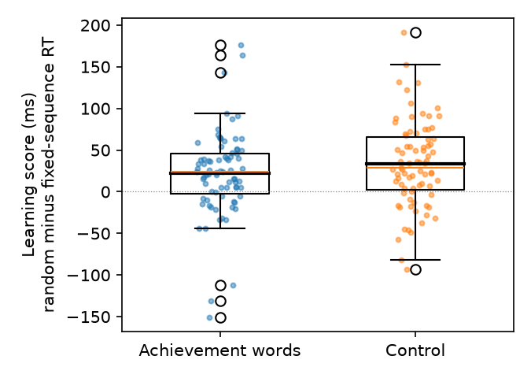

# S18: Do achievement words in a word search increase implicit sequence learning?

**Question.** Do participants who complete a word search containing achievement words (e.g., *win*, *excellence*) learn a hidden repeating sequence in a later key-press task better than participants whose word search contains neutral words?

**Data.** One SPSS file from an independent replication (`d07.sav`, 206 participants run). Condition 1 = achievement words, 2 = control.

**Sample after exclusions.** I kept participants with the analysis flag Include1 = 0 (the file's SPSS filter selects exactly these; it encodes the card's "Include for analyses"). That leaves **158 (79 achievement, 79 control)**. Excluded 48: 13 for technical failure or awareness of the link between tasks, 2 with a learning score more than 4 SD from the mean, and 33 run after the first 79 usable participants of their condition.

**Measure.** Learning score = mean RT of the two random test blocks minus mean RT of the fixed-sequence test block (ms; larger = more learning). The file's own `Learning` variable has the opposite sign (fixed minus random); I recomputed it as the card defines it and checked that the two agree up to sign.

**Primary test (fixed before the analysis).** Two-sided Student independent-samples t-test with equal variances, achievement minus control; Cohen's d with the pooled SD. The claim holds if d > 0 and p < .05.

## Result

| | n | Mean learning (ms) | SD |
|---|---|---|---|
| Achievement words | 79 | 22.3 | 51.3 |
| Control | 79 | 33.1 | 52.1 |

**t(156) = -1.32, p = .189.** Mean difference (achievement minus control) = -10.8 ms, 95% CI [-27.1, 5.4]. **Cohen's d = -0.21, 95% CI [-0.52, 0.10]** (pooled SD = 51.7 ms).

The difference points the opposite way to the prediction: the achievement group learned slightly *less* on average, and the difference is not significant. The upper end of the CI for d is 0.10, so the data exclude positive effects larger than about d = 0.1.

**Checks (not the basis of the conclusion).** Sequence learning itself occurred: mean learning across all 158 = 27.7 ms, t(157) = 6.72, p < .001, so the task worked. Welch t-test: t = -1.32, p = .189 (Levene p = .36). Mann-Whitney: p = .228. Learning score from median RTs: t = -1.84, p = .067 (same negative direction). All 197 participants with RT data, without exclusions: t = -1.71, p = .089 (negative direction). No check produced an effect in the predicted direction.

## Conclusion

**The claim does not hold on this data:** participants who saw achievement words did not show more sequence learning than controls (t(156) = -1.32, p = .189, d = -0.21 [-0.52, 0.10]); the estimate is in the opposite direction.

*Files:* `analysis.py` produces every number above; output in `analysis.out`; plan and commands in `log.md`.
