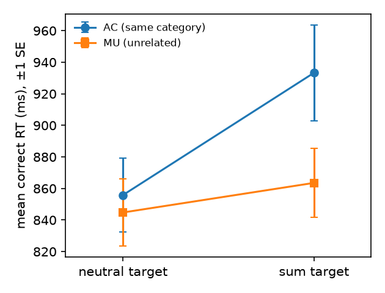

# S20 — Do category-aligned word pairs strengthen automatic activation of addition facts?

**Question.** Is the slowing in rejecting a digit target that equals the sum of the two cue digits (relative to a neutral digit) larger after a pair of same-category words (AC, e.g. *tulips–daisies*) than after a pair of unrelated words (MU, e.g. *hens–radios*)? Prediction: (sum − neutral)AC > (sum − neutral)MU.

**Data and sample.** Replication data, `d02.sav` (`d04.sav` is byte-identical, same SHA-256). The file has 320 rows, of which 49 hold data; 50 students were tested and one was excluded by the replication team before the file was made (fewer than 90% correct responses). No participant had a missing cell mean, so I excluded no one further: **N = 49**. The measure is each participant's mean correct-response latency in the four cells (non-matching digit target shown first; sum vs neutral target; after AC vs MU pairs). Error rates were 18–23% per cell. The number of trials per cell varied between participants (2–15; mean 34 of the expected 40 trials in total). I had only the cell means, not trial-level data, so I could not check this further.

**Plan (fixed before analysis, see `log.md`).** 2 × 2 repeated-measures ANOVA. The key term is the word pair × target interaction, F(1, 48) = t², where t is the one-sample t of D = (sum − neutral)AC − (sum − neutral)MU. The claim holds if p < .05 (two-sided) and the mean of D is positive.

**Cell means (ms, SD).** AC: sum 933.3 (213.1), neutral 855.8 (162.9). MU: sum 863.5 (152.7), neutral 844.8 (149.4).

**Primary result.** The sum − neutral slowing was 77.5 ms after AC pairs and 18.8 ms after MU pairs. That gives D = **58.7 ms, 95% CI [1.3, 116.2]**.
Interaction: **F(1, 48) = 4.22, p = .045, MSE = 9999**, partial η² = .081. Equivalently, t(48) = 2.06 and dz = 0.29, 95% CI [0.01, 0.58]. The effect runs in the predicted direction. A full AnovaRM fit gives the same F. The main effects were word pair, F(1, 48) = 8.43, p = .006, and target, F(1, 48) = 11.84, p = .001.

**Checks (not primary).**
- Simple effects: the sum slowing was reliable after AC pairs, t(48) = 3.37, p = .002, dz = 0.48. It was not reliable after MU pairs, t(48) = 1.14, p = .26.
- A Wilcoxon signed-rank test on D was at the threshold, p = .051.
- No participant was an outlier on D (|z| > 3).
- D was positive for 55% of participants.

The effect is therefore small and fragile: its CI lower bound is close to zero, and a rank-based test does not quite reach significance.

**Conclusion.** The claim holds on this data: the sum − neutral slowing was larger after same-category word pairs than after unrelated pairs, F(1, 48) = 4.22, p = .045. The effect is small, dz = 0.29, and its interval runs from nearly zero to moderate.

*Files: `analysis.py` produces every number above; its output is in `analysis.out`.*
