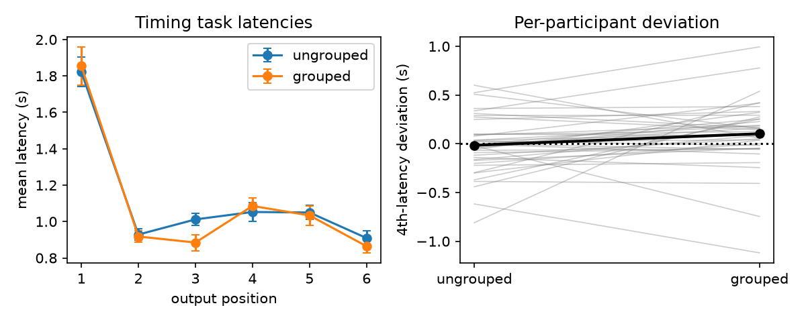

# S22: Does a grouping instruction put a gap into reproduced timing?

**Question.** When people are told to think of a six-item list as two groups of three, does the 4th response latency in a *timing* (rhythm-reproduction) task sit further above the trend of the surrounding latencies than under standard, ungrouped instructions?

**Data and sample.** Replication file `d03.csv`, one row per trial: 40 participants × 80 trials (20 per task × instruction cell). The file holds only the 40 participants retained under the protocol; I applied no further exclusions. All 40 have 20 timing trials in each instruction condition; no latencies are missing or non-positive. N after exclusions = 40 (0 excluded here).

**Measure (as specified in advance).** Timing trials only. For each participant and instruction, I averaged each of the six output latencies over the 20 trials, fitted a quadratic (latency on position) to positions 2, 3, 5 and 6, and took the mean 4th latency minus the quadratic's prediction at position 4.

**Primary test.** Paired-samples t-test, two-sided, of the deviation, grouped vs ungrouped. Effect size d_av = mean difference / sqrt of the mean of the two variances. Its 95% CI comes from a percentile bootstrap over participants (10,000 resamples). The claim counts as holding if the grouped deviation is larger with p < .05.

## Result

| | Ungrouped | Grouped |
|---|---|---|
| 4th-latency deviation, mean (SD), s | −0.015 (0.294) | 0.104 (0.352) |

- Mean difference (grouped − ungrouped) = **0.119 s**, 95% CI [0.004, 0.235].
- **t(39) = 2.08, p = .044**, two-sided.
- **d_av = 0.37**, 95% bootstrap CI [0.03, 0.78] (d_z = 0.33). 28 of 40 participants showed a larger deviation under grouping.

Under ungrouped instructions the 4th latency sits on the trend (t(39) = −0.33, p = .74). Under grouping instructions it sits about 0.10 s above the trend (t(39) = 1.87, p = .070).

**Checks (not the basis of the conclusion).**

- A Wilcoxon signed-rank test on the same difference agrees: W = 236, p = .019.
- The planned, less specific 2 × 6 repeated-measures ANOVA on raw timing latencies gives an instruction × position interaction of F(5, 195) = 2.54, p = .030 uncorrected. With the Greenhouse–Geisser correction it is p = .065 (ε = .55).
- Added after I saw some very long trial latencies (20 of 9,600 exceed 5 s; the maximum is 27.7 s): using per-cell medians gives t(39) = 2.43, p = .020. Dropping latencies over 5 s gives t(39) = 2.51, p = .016.
- For context, the order (NUMBERS) task shows the same pattern more strongly: t(39) = 3.03, p = .004.

**Limitations.** The effect is small to moderate, and the CI on the difference runs from almost zero to 0.24 s, so the estimate is imprecise. Instruction is confounded with task half because of the fixed order (ungrouped first). Part of the change could therefore come from practice or fatigue, although a practice effect would not obviously target position 4 alone.

**Conclusion.** The claim holds on this data. Under grouping instructions, the 4th latency in the timing task rises reliably more above its trend than under ungrouped instructions (t(39) = 2.08, p = .044, d_av = 0.37), but the effect is modest and its lower confidence bound is close to zero.
