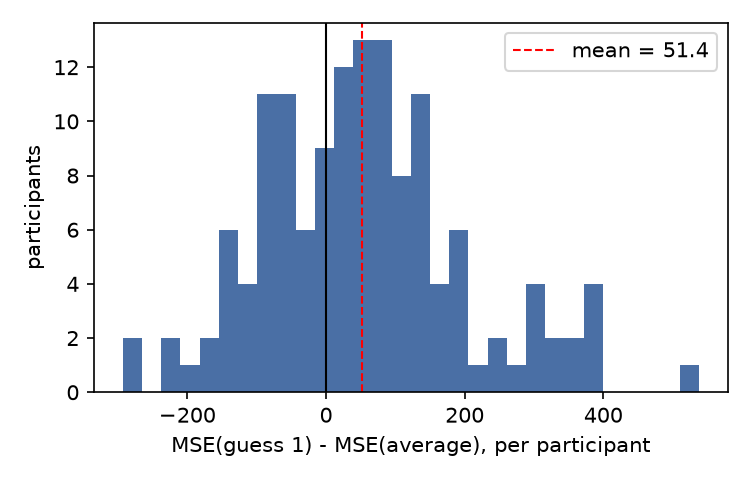

# S23: Does averaging a person's first estimate with a delayed second estimate beat the first estimate?

**Question.** When one person estimates the same quantity twice, the second time unannounced about three weeks later, is the mean squared error (MSE) of the average of the two guesses lower than the MSE of the first guess alone?

**Data and sample.** Session 1 (`d04.txt`, 231 rows) and session 2 (`d05.txt`, 171 rows) of the delayed condition, eight percentage-estimation questions each, merged on `student_number_simple`. Some IDs occur more than once within a session (5 IDs in session 1, one of them blank; 3 IDs in session 2); as planned before the analysis, I dropped those because they cannot be matched unambiguously, leaving **160** matched participants. Exclusions, applied in order: browser defocus on any question in either session (**20**), any of the 16 answers missing (**1**), admitted looking up answers in session 2 (`peaking` not "Nee") (**1**). **n = 138** after exclusions. The card's sample definition keeps the duplicate-ID rows (174 matched, 140 after the same exclusions, 125 women and 15 men); that version is reported as a robustness check.

**Measures.** Per participant, with truths 6.3, 43.3, 32.3, 13.4, 53.6, 54.8, 26.4, 22.4: MSE1 = mean over the 8 questions of (guess1 − truth)²; MSEavg = mean of ((guess1 + guess2)/2 − truth)².

**Primary test (fixed in advance).** Paired t-test of MSE1 vs MSEavg; the claim holds if MSE1 > MSEavg with two-sided p < .05. Effect size d_z = mean difference / SD of differences, 95% CI by inverting the noncentral t.

## Result

| | n | MSE1 mean (SD) | MSEavg mean (SD) | Diff [95% CI] | t (df) | p (two-sided) | d_z [95% CI] |
|---|---|---|---|---|---|---|---|
| **Primary** | 138 | 521.0 (288.6) | 469.6 (261.5) | 51.4 [26.5, 76.2] | **t(137) = 4.09** | **7.3 × 10⁻⁵** | **0.35 [0.18, 0.52]** |
| Card sample (duplicates kept) | 140 | 517.4 (288.1) | 467.5 (260.3) | 50.0 [25.4, 74.5] | t(139) = 4.02 | 9.4 × 10⁻⁵ | 0.34 [0.17, 0.51] |
| No exclusions (complete answers only) | 159 | 526.7 (302.0) | 469.6 (273.7) | 57.0 [34.0, 80.1] | t(158) = 4.88 | 2.5 × 10⁻⁶ | 0.39 [0.23, 0.55] |

The average beat guess 1 for 64% of participants. A Wilcoxon signed-rank test agrees (W = 3118, p = .0004). The average was more accurate than guess 1 on 7 of 8 questions (not on q4). Descriptively, the delayed second guess alone was *less* accurate than the first (MSE2 = 591.4; MSE1 − MSE2 = −70.4, t(137) = −2.83, p = .005), yet the average still beat both guesses (MSE2 vs MSEavg: t(137) = 8.39, d_z = 0.71). Guesses 1 and 2 correlate only moderately across people (r = .35 to .62 by question), and 13.5% of answers were repeated exactly.

**Conclusion.** The claim holds on this data: averaging a person's first estimate with their own estimate three weeks later reduced mean squared error relative to the first estimate alone (t(137) = 4.09, p < .001, d_z = 0.35, 95% CI [0.18, 0.52]).

*Files: `analysis.py` produces every number above; output in `analysis.out`; plan and commands in `log.md`.*
