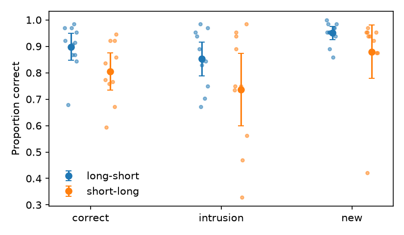

# S24: Does the long-list group recognise less accurately than the short-list group?

**Question.** In a single-probe recognition task (study a list of words, judge whether one test word was in it), is the group labelled `long-short` less accurate than the group labelled `short-long`, pooled over the three test-word types (`correct`, `intrusion`, `new`)?

**Data and sample.** The replication's wide file (`d03.sav`): one row per participant with the proportion correct for each test-word type, from 8 blocks of 32 trials (128 `correct`, 64 `intrusion`, 64 `new` probes per person). I recomputed every proportion from the trial-level file (`d05.csv`, 5,376 trials) and it matched the wide file exactly. **N = 21** (11 `long-short`, 10 `short-long`); **no exclusions**, as the design specifies. One note on the data: in the trial file every list in both groups has six words, so what distinguishes "long" from "short" is not recorded in the files; I follow the card's labelling (the first word of the label is the group's type).

**Primary test (fixed before analysis).** 2 (list type, between) × 3 (test-word type, within) mixed ANOVA, type-III sums of squares, DV = proportion correct. Key term: the list-type main effect. The claim holds if this term is significant at α = .05 *and* the `long-short` group is less accurate.

| Group | n | correct | intrusion | new | mean of three |
|---|---|---|---|---|---|
| long-short | 11 | .898 (.086) | .852 (.108) | .950 (.042) | .900 (.071) |
| short-long | 10 | .805 (.115) | .736 (.222) | .880 (.164) | .807 (.144) |

Means (SD) of per-participant proportion correct.

**Result.** List-type main effect: **F(1, 19) = 3.66, p = .071, partial η² = .16, 95% CI [.00, .43]** (90% CI [.00, .38]). The difference in mean accuracy, `long-short` minus `short-long`, is **+.093, 95% CI [−.009, +.195]** (Hedges g = 0.80). The direction is the *opposite* of the claim: the `long-short` group was, if anything, more accurate, in all three test-word types. Other terms: test-word type F(2, 38) = 9.59, p < .001, partial η² = .34 (intrusions hardest, new words easiest); interaction F(2, 38) = 0.35, p = .71.

**Secondary and robustness checks (not the basis of the conclusion).** On the `new` column alone (the original narrower prediction): `long-short` M = .950 vs `short-long` M = .880, t(19) = 1.38, p = .18 (Welch p = .22; Mann–Whitney p = .074), again in the direction opposite to the claim. Dropping the one low-accuracy participant (106, `short-long`; added after seeing the data) gives F(1, 18) = 2.49, p = .13; a Mann–Whitney test on participant means gives p = .11. None of these change the picture.

**Limitations.** Twenty-one participants give low power for a between-subjects effect; the 95% CI for the group difference runs from a 1-point disadvantage to a 20-point advantage for the `long-short` group. The files do not show what "long" and "short" refer to (all lists have six words), so the reading of the labels rests on the card.

**Conclusion.** The claim does not hold on this data: the list-type main effect is not significant (F(1, 19) = 3.66, p = .071), and its point estimate runs the other way, with the `long-short` group more accurate, not less.
