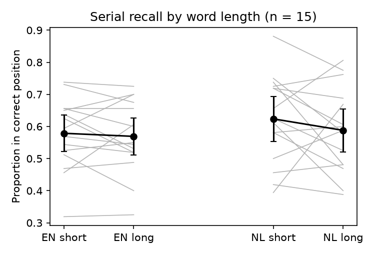

# S25: Are short-word lists recalled in order better than long-word lists?

**Question.** In immediate serial recall of eight-word lists, is the proportion of words placed in their correct serial position higher for lists of short (one-syllable) words than for lists of long (multi-syllable) words? Confirmatory test: English lists only; one-sided, short > long.

**Data and sample.** Seventeen tab-separated text files were supplied for a study the card describes as having 15 participants. Two files (d21, d22) each held a label line, four demographic lines and 80 trial rows; their trial rows were byte-for-byte identical to d06 and d17 respectively, so they were dropped as duplicate copies (a rule fixed in the log before any analysis). That left **n = 15** distinct participants, each with 80 trials (20 per language x length cell). As the card specifies, no participants or trials were excluded. As a check, recomputing `nr_correct` from the presented and clicked words reproduced the stored value on all 1,200 English trials.

**Measure.** For each participant and cell: the mean of `nr_correct / 8` over 20 lists, rounded to three decimals.

**Test (pre-specified).** A paired t-test of English short vs English long, one-sided (H1: short > long), with df = n - 1. Effect size d_z = t / sqrt(n), with a 95% CI from the noncentral t. The claim would count as holding if p < .05 in the predicted direction.

## Result

| Cell | Mean | SD |
|---|---|---|
| English short | 0.579 | 0.112 |
| English long | 0.569 | 0.114 |
| Dutch short (exploratory) | 0.624 | 0.138 |
| Dutch long (exploratory) | 0.588 | 0.133 |

**Primary:** mean difference (short - long) = 0.010 (95% CI -0.032 to 0.051), **t(14) = 0.50, one-sided p = .31, d_z = 0.13 (95% CI -0.38 to 0.63)**. Eight of the 15 participants scored higher on short lists, six scored higher on long lists and one scored the same on both.

**Robustness (not the basis of the conclusion).** These checks agree with the primary test:
- With the unrounded measure: t(14) = 0.49, p = .31.
- Wilcoxon signed-rank, one-sided: p = .24.
- Dutch lists (exploratory): difference 0.036, t(14) = 0.99, one-sided p = .17.
- Language x length interaction: p = .47.

**Limitations.** With n = 15, the CI for d_z is wide. It runs up to about 0.6, so a moderate effect is not ruled out. The point estimate is small, however, and the observed difference is about one percentage point. Participants were mostly native Dutch speakers recalling English, their second language.

**Conclusion.** The claim does not hold on this data: English short-word lists were not recalled in correct serial order reliably better than long-word lists (t(14) = 0.50, one-sided p = .31, d_z = 0.13).
