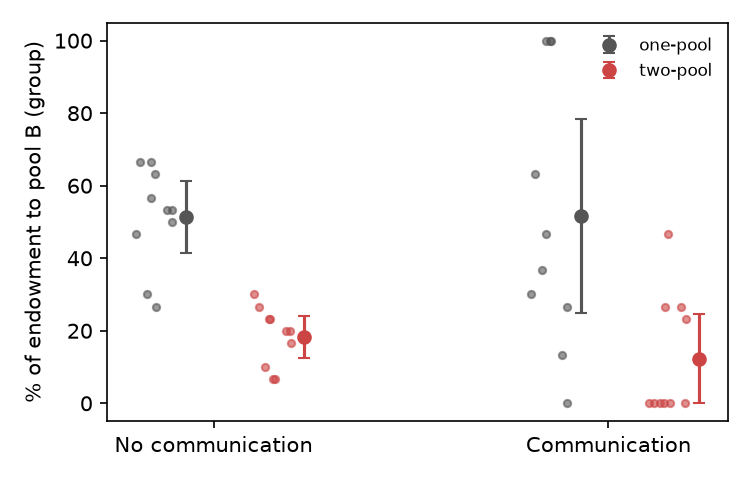

# S26 — Does a harmless way to help the ingroup reduce contributions to the pool that harms the outgroup?

**Question.** When group members can help their own group without harming the other group (two-pool game: pools W and B), do they give less to the outgroup-harming pool B than when B is the only pool (one-pool game)?

**Data and sample.** Replication raw data, individual file `d05.sav` (120 participants), aggregated to the 3-person group (`Group_Num`), the unit of analysis named on the card. All 40 groups had 3 members and a single condition; 10 groups per cell of the 2 (game) x 2 (communication) design. No missing values; **no exclusions** (n = 40 groups). The group means match the provided group-level file `d04.sav` (Pool_B_Percent) to within 0.003 percentage points.

**Test (fixed in the log before the data were opened).** 2 x 2 between-groups ANOVA (Type III; balanced, so identical to Type I) on the group mean of `GivePool_B` (tokens 0–10). Key term: game main effect, F(1, 36). The claim holds if that effect is significant at .05 and two-pool < one-pool.

**Descriptives (group-mean tokens to pool B, of 10; mean (SD)).**

| Game | No communication | Communication | Marginal |
|---|---|---|---|
| One-pool (B only) | 5.13 (1.39) | 5.17 (3.75) | 5.15 (2.75) |
| Two-pool (W and B) | 1.83 (0.82) | 1.23 (1.71) | 1.53 (1.34) |

**Result.** Game main effect: **F(1, 36) = 26.76, p = 8.8 x 10^-6, partial eta^2 = .43, 95% CI [.17, .58]**. Groups in the two-pool game gave 3.62 fewer tokens to pool B (95% CI 2.20 to 5.03), i.e. 15% vs 52% of the endowment. Communication (F(1, 36) = 0.16, p = .69) and the interaction (F(1, 36) = 0.21, p = .65) were not significant.

**Checks.** Variances are unequal across cells (Levene p = .005; the one-pool + communication cell is very spread, from 0% to 100%), so the ANOVA's homogeneity assumption is strained. The game effect survives tests that do not rely on it: Welch t(27.5) = −5.29, p = 1.3 x 10^-5; Mann–Whitney U = 40, p = 1.5 x 10^-5; individual-level regression with group-clustered SEs, p < .001. The ANOVA on the provided Pool_B_Percent gives the same F. One caveat the design imposes: two groups from the same six-person cohort played each other, so the 40 groups are not strictly independent (20 cohorts); the effect is large enough that this is unlikely to change the conclusion, but it was not modelled. Secondary (not the key test): in the two-pool game, communication did not significantly change pool-W giving (4.87 vs 3.50 tokens, t(18) = 1.18, p = .25).

**Conclusion.** The claim holds on this data: groups contributed substantially less to the outgroup-harming pool B when a harmless ingroup pool was also available (F(1, 36) = 26.8, p < .001, partial eta^2 = .43).

*Files: `analysis.py` produces every number here; output in `analysis.out`; plan and commands in `log.md`.*
