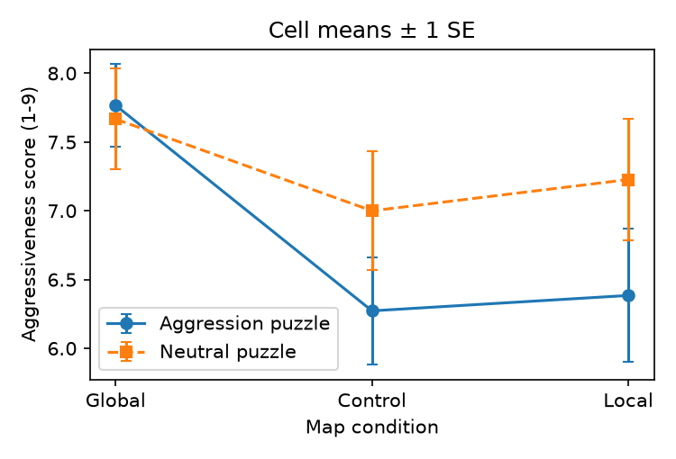

# S28 — Does map focus moderate the effect of an aggression word puzzle on judgements of an ambiguous target?

**Question.** After an aggression (vs neutral) word-search puzzle, is the ambiguous target "John" rated as *more* aggressive by participants who first attended to a map's overall shape (Global) or to both shape and details (Control), and *less* aggressive by those who attended to its details (Local)? Tested as the map × puzzle interaction.

**Data and sample.** Independent replication data (`d09.csv`), 74 participants, 3 (map: Global, Local, Control) × 2 (puzzle: Aggression, Neutral) between-participants. Exclusions fixed before analysis, following the card: 3 participants who guessed the study's purpose (`discard == 1`) were removed; no participant was missing the dependent measure; both rows with PID 18 were kept. **N = 71.** The DV `aggressivenessScore` (mean of the assertive–hostile and determined–belligerent scales, 1–9) was checked: it equals (Q5+Q8)/2 in every row.

**Primary test (named in advance).** Between-participants ANOVA `aggressivenessScore ~ map × puzzle` (type III, sum-to-zero contrasts; type II gives the same interaction SS). The claim holds if the interaction is significant (p < .05) with the aggression-minus-neutral difference positive under Global and Control and negative under Local.

| Map | Aggression: n, M (SD) | Neutral: n, M (SD) | Aggression − Neutral |
|---|---|---|---|
| Global | 15, 7.77 (1.16) | 12, 7.67 (1.27) | +0.10 |
| Control | 11, 6.27 (1.29) | 9, 7.00 (1.30) | −0.73 |
| Local | 13, 6.38 (1.75) | 11, 7.23 (1.46) | −0.84 |

**Result.** Map × puzzle interaction: **F(2, 65) = 0.87, p = .426, partial η² = .026, 95% CI [.000, .114].** The pattern also does not match the claim: the aggression puzzle produced no difference after Global focus (+0.10, d = 0.08) and *lower*, not higher, ratings in the Control condition (−0.73, d = −0.56), similar to the Local condition (−0.84, d = −0.52); none of the three simple effects is significant (Welch p = .83, .23, .21).

**Checks (not the basis of the conclusion).** A one-df contrast of the prime effect in Local vs the average of Global and Control: 0.53, t(65) = 0.76, p = .45, 95% CI [−0.87, 1.93]. ANOVA on ranks: interaction p = .50. Keeping the 3 excluded participants (N = 74): F(2, 68) = 0.68, p = .51. The only reliable effect in the data is a main effect of map condition, F(2, 65) = 4.29, p = .018: Global participants rated John as more aggressive regardless of puzzle; the puzzle main effect is n.s. (p = .15).

**Limits.** Cells are small (9–15), so the interval on partial η² reaches .11 — a moderate interaction cannot be ruled out by this sample alone. But the point estimate is small, and the observed direction in the Control condition is the opposite of what the claim predicts.

**Conclusion.** The claim does not hold on this data: the map × puzzle interaction is small and not significant (F(2, 65) = 0.87, p = .43), and the cell pattern does not follow the predicted assimilation (Global/Control) vs contrast (Local) shape.

*Files:* `analysis.py` produces every number (`analysis.out`); plan and commands in `log.md`.
