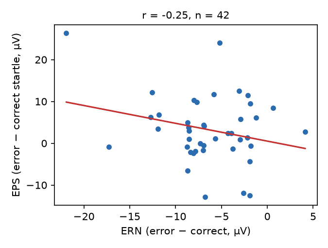

# S29 — Does a larger error-related negativity go with a larger error-potentiated startle?

**Question.** Across people, is a larger (more negative) error response in the EEG (`ERN`, error-minus-correct mean amplitude 0–100 ms after the response, µV) associated with a larger increase in the startle eye-blink after errors relative to correct responses (`EPS`, µV)? The claim predicts a **negative** Pearson correlation.

**Data and sample.** Replication file `d05.csv` (byte-identical to `d08.csv`), long format with three probe-type rows per participant; `ERN` and `EPS` were verified constant within participant, and one row per participant (the `error` rows) was used. The posted file holds the 42 participants retained under the protocol (impedance and muscle-artefact exclusions applied before posting); no further exclusions were made and no ERN/EPS values were missing. **n = 42.** ERN: M = −6.44 µV, SD = 4.73; EPS: M = 3.25 µV, SD = 7.95.

**Test (named in advance).** Pearson product-moment correlation between ERN and EPS, df = n − 2, one-tailed in the predicted negative direction; the claim holds if r < 0 with one-tailed p < .05. Effect size is r with a Fisher-z 95% CI.

**Result.** r(40) = −0.253, t(40) = −1.66, **one-tailed p = .053** (two-tailed p = .106). 95% CI for r: [−0.517, 0.055]; one-sided 95% upper bound 0.005.

**Robustness (not primary).** The correlation rests heavily on one participant (id 1: ERN = −21.9 µV, EPS = 26.4 µV; |z| > 3 on both variables). Without that participant, r(39) = −0.020, one-tailed p = .45. The rank-based Spearman correlation on all 42 is ρ = −0.062 (one-tailed p = .35). So the direction is as predicted, but the linear association is weak and driven by a single extreme case.

**Conclusion.** The claim does not hold on this data: the correlation is in the predicted negative direction (r = −0.25) but does not reach one-tailed significance (p = .053), and it disappears when one extreme participant is removed or ranks are used.

*Files: `analysis.py` produces every number above; output in `analysis.out`; plan and commands in `log.md`.*
