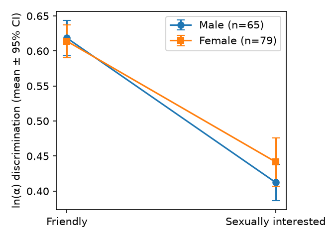

# S30: Do men separate women's sexual interest from friendliness less well than women do?

**Question.** Are men less able than women to tell a woman's friendliness apart from her sexual interest in photographs? Tested as the Gender × stimulus-category (friendly vs sexually interested) interaction on the per-category discrimination score ln(α); the claim predicts that men's deficit is larger for sexually interested than for friendly images.

**Data and sample.** Replication data file `d02.sav`: 144 heterosexual undergraduates (65 men, 79 women), each classifying 280 photographs into four categories. Discrimination scores `Sens_Friend` and `Sens_SI` were used as precomputed (the file holds only per-category hit/FA/miss totals, not the full confusion matrix, so they cannot be recomputed). **Exclusions: none** (0 rows missing Gender or either score); N = 144.

**Primary test (fixed before analysis).** 2 (category, within) × 2 (gender, between) mixed ANOVA; key term the interaction, equivalent to a one-way ANOVA on Sens_Friend − Sens_SI. The claim holds if the interaction is significant (α = .05) in the predicted direction.

| | Men (n = 65) | Women (n = 79) |
|---|---|---|
| Friendly ln(α), M (SD) | 0.619 (0.105) | 0.614 (0.107) |
| Sexually interested ln(α), M (SD) | 0.412 (0.108) | 0.442 (0.156) |
| Friendly − SI gap, M (SD) | 0.206 (0.156) | 0.172 (0.206) |

**Result.** Gender × category interaction: **F(1, 142) = 1.19, p = .276, partial η² = .008, 95% CI [.000, .061]**. The pattern points the predicted way (men are 0.029 lower than women on sexual interest and 0.005 higher on friendliness, so their friendly−SI gap is 0.034 larger), but the difference is small and not distinguishable from zero: Cohen's d on the gap = 0.18, 95% CI [−0.15, 0.51]; bootstrap 95% CI for the mean difference [−0.025, 0.092].

Main effects: category was large (F(1, 142) = 147.8, p < .001, partial η² = .51; friendliness was much easier to discriminate than sexual interest for everyone); gender was not (F(1, 142) = 0.86, p = .354).

**Robustness.** Welch t on the gap: t = 1.12, p = .264. Mann–Whitney: U = 2911.5, p = .168. Adding presentation time (500 vs 3000 ms): gender on the gap F(1, 140) = 1.00, p = .319; gender × presentation time F(1, 140) = 1.11, p = .294. Per-category gender differences (Welch): friendly p = .80, sexually interested p = .19 (d = −0.22); the largest male deficit was for rejecting images (d = −0.32, p = .057), a category outside the claim.

**Conclusion.** The claim does not hold on this data: the gender × category interaction is small and not significant (F(1, 142) = 1.19, p = .28), although its direction matches the prediction.

*Limitations:* with n = 144 the test has 78% power for partial η² = .05 and 40% for .02, so a small effect cannot be ruled out (the upper CI bound is .061).
