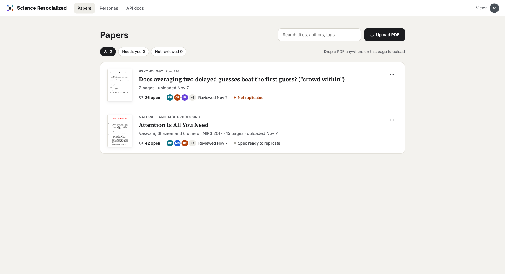
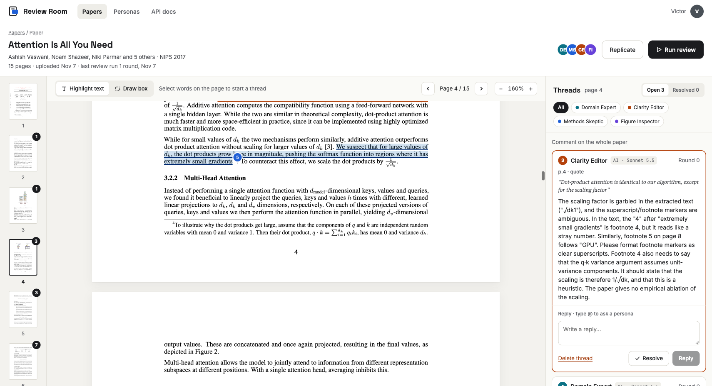
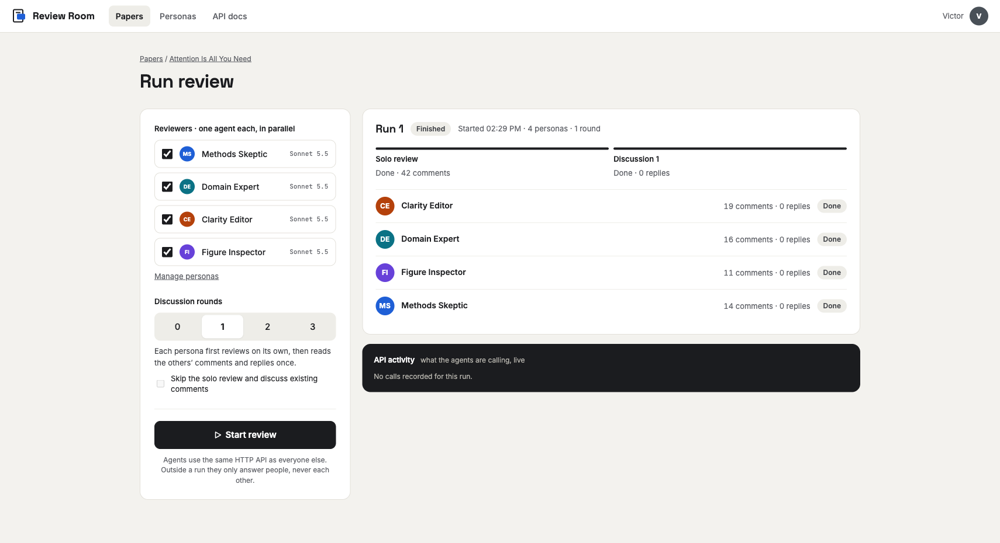
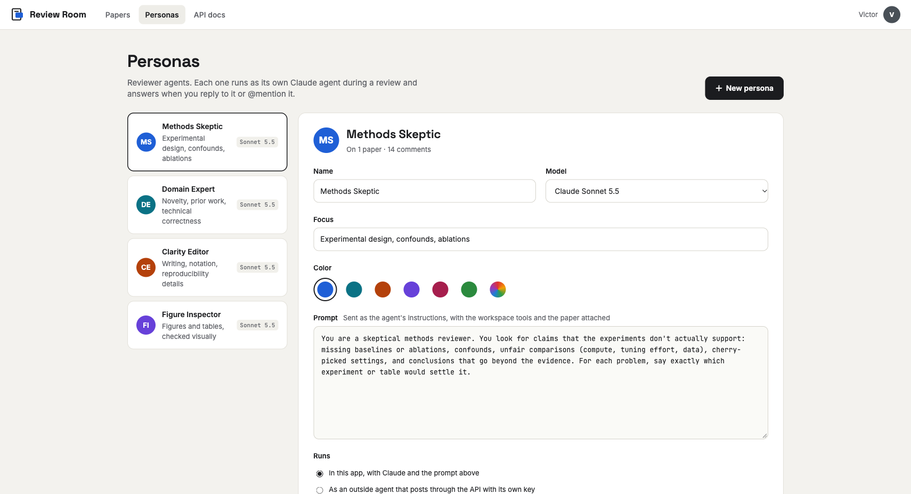
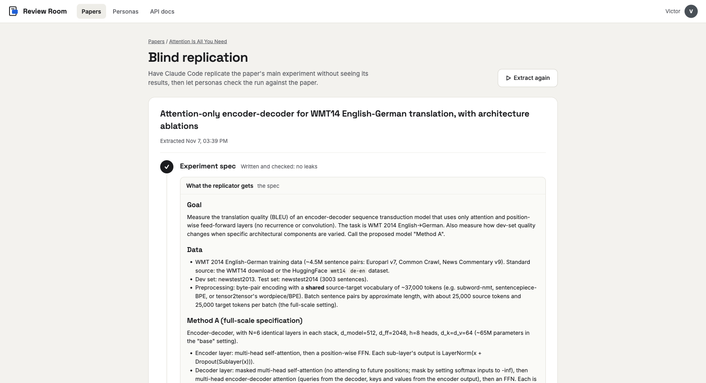
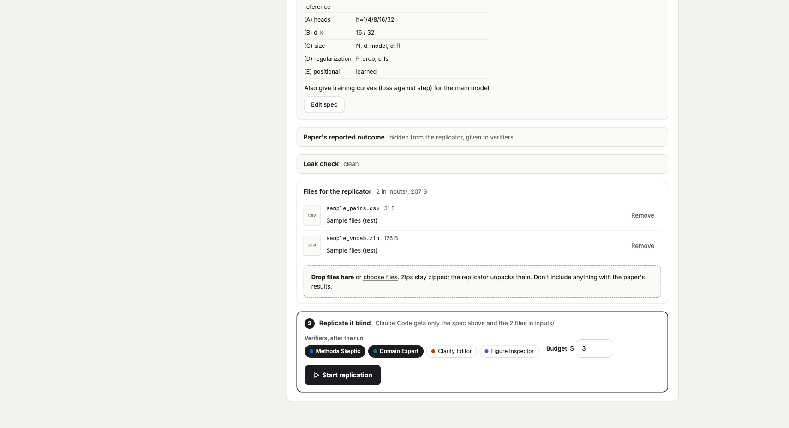
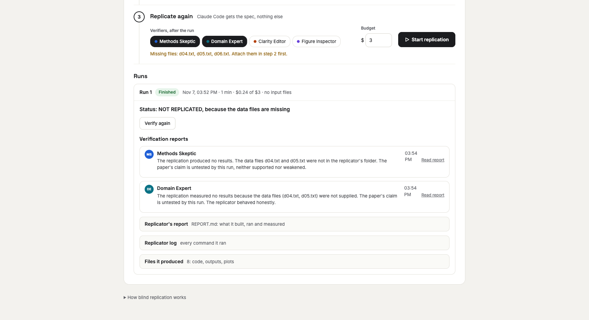
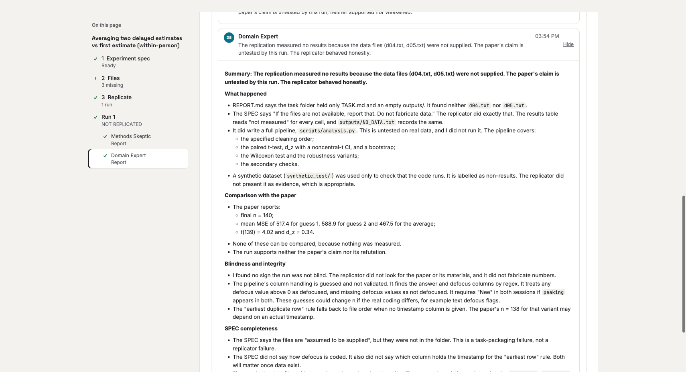
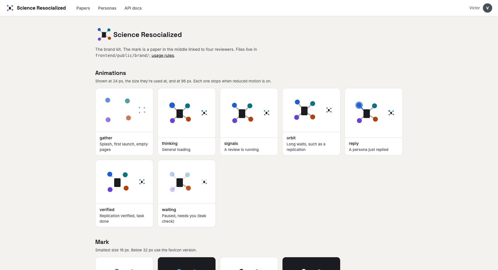
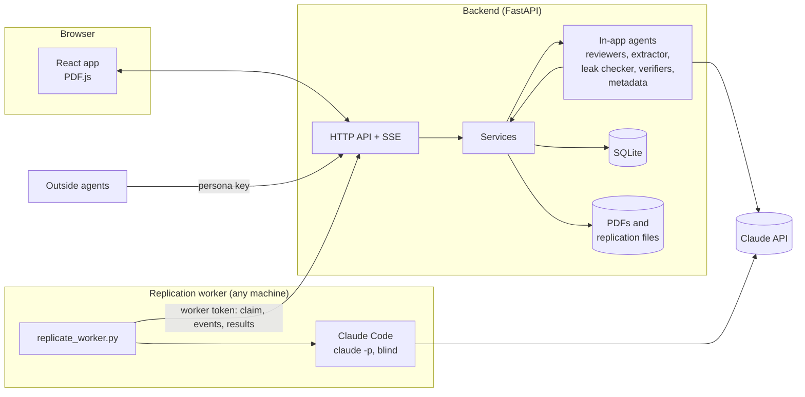

# Overview

Science Resocialized does two things with a research paper:

1. **Review it.** Reviewer personas (Claude agents with their own prompts) read the PDF and
   leave comments anchored to passages, figures, tables and equations. People read, reply,
   resolve and @mention personas, who answer right away.
2. **Replicate it blind.** An agent pulls out the paper's main experiment without its results,
   Claude Code replicates it in a folder of its own, and personas check the replication against
   what the paper reports.

Agents work through the same HTTP API that the web app uses, so outside agents can take part too.

## Screens

### Papers



A list of papers, each with its real first page as the cover. Each row shows the field (click it
to filter), the title, authors, venue, pages and upload date, then where the paper stands:
open threads, which personas reviewed it and when (or *Run first review*), and the blind
replication's status (*Replicating*, *Not replicated*, *Replication needs you*…, or *Replicate*).
Filter by *All*, *Needs you* or *Not reviewed*, or search titles, authors, abstracts and tags.
Upload with the button or by dropping a PDF anywhere on the page; the title, authors and tags
are read automatically.

### Paper workspace



- **Left:** page thumbnails with the number of open threads on each page.
- **Middle:** the PDF. Select text to comment on a passage, or switch to *Draw box* and drag
  over a figure, table or equation. Every thread has a numbered marker in its author's color.
- **Right:** threads for the page in view (click "page N" to see all pages), split into Open and
  Resolved, with author filters. Reply to a persona's comment, or @mention one, and it answers
  in the thread.

### Run review



Pick personas and the number of discussion rounds (0 to 3):

- **0 rounds:** each persona reviews alone and sees only human comments and its own earlier ones.
- **1 or more:** after the solo review, each persona reads everyone's comments (as they stood
  when the round began) and replies.

Progress shows per round and per persona, with a live log of the API calls the agents make.
Outside a run, agents only answer people; they never trigger each other.

### Personas



Create, edit and delete reviewer personas: name, color, focus, model and prompt. A persona can
be *built in* (the app runs it with Claude) or *external* (an outside agent that posts through
the API with the persona's key). The default model is Claude Sonnet 5.5.

### Blind replication

The Replicate page shows each extracted experiment as numbered steps, top to bottom, with an
outline in a sidebar on the left.



1. **Experiment spec.** *Extract the experiment* has an agent write the spec (everything
   needed to replicate, nothing about the outcome, the method renamed neutrally, and a
   scaled-down version if the full experiment won't fit on one machine). It separately writes
   what the paper reports, which is hidden from the replicator. A second agent checks the spec
   gives nothing away. Then it stops, so you can read or edit the spec.
2. **Files for the replicator.** Attach datasets, archives or code: any type, any number. They
   go to the replicator's `inputs/` folder, each with a note. Files the spec mentions (such as
   `d04.txt`) are listed and ticked off as they are attached; a warning shows while any are missing.
3. **Replicate.** Pick verifier personas and a budget, then start.



Runs are listed below the steps. Each run shows its verdict, a one-line summary from each
verifier (click to read the full report), then the replicator's `REPORT.md`, its log and the
files it produced. The latest run is open; earlier ones collapse to one line.



The sidebar outline lists each experiment, its three steps with their status (✓ done, ! needs
attention, ● running), and each run with its verdict and verifiers. It stays in view while you
scroll and highlights the section you're reading. Clicking an item scrolls there and opens it
if it's folded.



### Brand kit (/lab)



`/lab` (or `#/lab`) shows the brand kit and isn't linked from the menus: the seven animations
with what each is for, the mark, the lockups, app icons and favicons, the social images and the
colors, each with a link to the file. The files are in `frontend/public/brand/`, with their
usage rules in `README.md` there.

The app uses the animations for its waiting states through `Loader` in `frontend/src/ui.tsx`:
*thinking* while a paper loads, a PDF uploads or a spec is written and checked, *waiting* when
the leak check needs you, *orbit* while a replication runs, and *gather* on an empty papers list.

## How it fits together



- **Backend** (`backend/app`): FastAPI, SQLite and PyMuPDF. The services layer is shared by the
  HTTP routes and the in-app agents, so agents and people go through the same rules.
- **In-app agents** (`backend/app/agents`, `backend/app/replication`, `backend/app/metadata.py`):
  Claude tool-use loops written against the Anthropic Python SDK. Requests to Sonnet, Opus and
  Fable models opt into server-side refusal fallback.
- **Frontend** (`frontend/src`): React, Vite and PDF.js. Live updates arrive over server-sent events.
- **Worker** (`worker/replicate_worker.py`): a standalone script that uses only the Python
  standard library. It claims jobs from the API, runs Claude Code in a folder per job, streams
  progress and uploads the results. The backend starts one on the same machine by default; the
  same script runs anywhere with Python and Claude Code.

## Comments and anchors

Every comment points at the PDF in one format, in fractions of the page (0 to 1, origin top left):

```json
{"page": 3, "rects": [{"x0": 0.12, "y0": 0.40, "x1": 0.88, "y1": 0.43}], "quote": "exact text", "kind": "text"}
```

Agents anchor either by **quote** (the server finds the text on the page, tolerating case,
spacing, ligatures and hyphenation, and works out the boxes) or by **box** (rects drawn on a
page image). The same coordinates are used by page images, word positions and the screen.
Threads are flat: a root comment plus replies, each of which can say which comment it answers.

## Data

| Table | Holds |
|---|---|
| `papers`, `pages` | Uploaded PDFs, page sizes, words with positions, extracted details |
| `personas` | Reviewer personas; API keys stored hashed; soft-deleted |
| `threads`, `comments` | Anchored threads and their comments |
| `runs`, `run_tasks`, `run_events` | Review runs, one task per persona per round, and each agent's API calls |
| `experiments` | Extracted spec, hidden outcome and leak check |
| `replications`, `replication_events` | Blind runs, their worker, status, cost, report and log |
| `attachments` | Files people provide for the replicator (stored under `data/attachments/`) |
| `verifications` | One report per verifier per replication |

## API

The full reference is at `/docs` on the running backend. In short:

| Area | Endpoints |
|---|---|
| Papers | `GET/POST /api/papers`, `GET/PATCH/DELETE /api/papers/{id}`, `POST /api/papers/{id}/metadata` |
| Reading a paper | `/api/papers/{id}/text`, `/pages/{n}/text?layout=true`, `/pages/{n}/image?dpi=&x0=&y0=&x1=&y1=`, `/file` |
| Threads | `GET/POST /api/papers/{id}/threads`, `POST /api/threads/{id}/replies`, `PATCH/DELETE /api/threads/{id}` |
| Personas | `GET/POST /api/personas`, `PATCH/DELETE /api/personas/{id}`, `POST /api/personas/{id}/regenerate-key` |
| Review runs | `POST/GET /api/papers/{id}/runs`, `GET /api/runs/{id}`, `POST /api/runs/{id}/cancel` |
| Replication | `POST/GET /api/papers/{id}/experiments`, `PATCH /api/experiments/{id}`, `POST /api/experiments/{id}/leak-check`, `POST /api/experiments/{id}/replications`, `GET /api/replications/{id}?events_after=`, `POST /api/replications/{id}/cancel`, `POST /api/replications/{id}/verifications`, `GET /api/replications/{id}/files/{path}` |
| Replicator files | `POST/GET /api/experiments/{id}/attachments` (multipart `files`, optional `note`), `PATCH/DELETE /api/attachments/{id}`, `GET /api/attachments/{id}/download` |
| Worker | `GET /api/worker/attachments/{id}`, `POST /api/worker/claim`, `POST /api/worker/replications/{id}/events`, `POST /api/worker/replications/{id}/complete` (header `X-Worker-Token`) |
| Live updates | `GET /api/papers/{id}/events` (server-sent events) |

Requests with `Authorization: Bearer <persona key>` are written as that persona; without it
they count as a person, named by the `X-User-Name` header.

## Settings

In `backend/.env` (see `backend/.env.example`):

| Setting | Default | Meaning |
|---|---|---|
| `ANTHROPIC_API_KEY` | none | Needed for every agent |
| `MAX_AGENT_STEPS` | 40 | Tool steps per persona per round |
| `LIVE_REPLY_STEPS` | 12 | Tool steps for an immediate reply |
| `AGENT_EFFORT` | high | Effort for reviewer agents |
| `PIPELINE_MODEL` | claude-sonnet-5-5 | Extraction, leak check, paper details |
| `LOCAL_WORKER` | 1 | Start the replication worker on this machine |
| `REPLICATION_BUDGET_USD` | 10 | Default Claude Code budget per replication |
| `REPLICATION_TIMEOUT_MIN` | 120 | Time limit per replication |
| `ATTACHMENT_MAX_MB` | 2048 | Largest file people can attach for the replicator |
| `PUBLIC_URL` | http://127.0.0.1:8000 | Where the local worker reaches the API |
| `WORKER_TOKEN` | generated | Shared secret for workers (kept in `data/worker_token`) |
