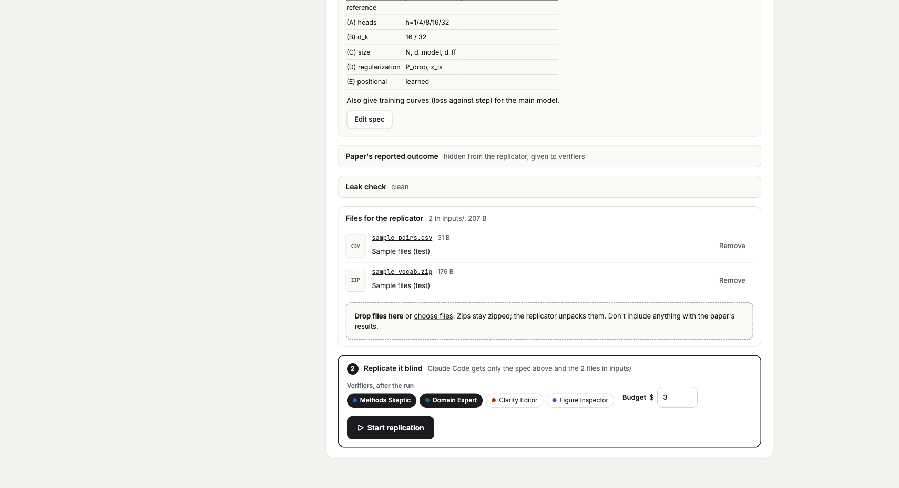
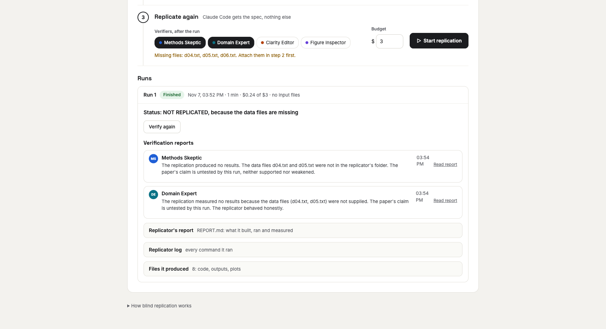
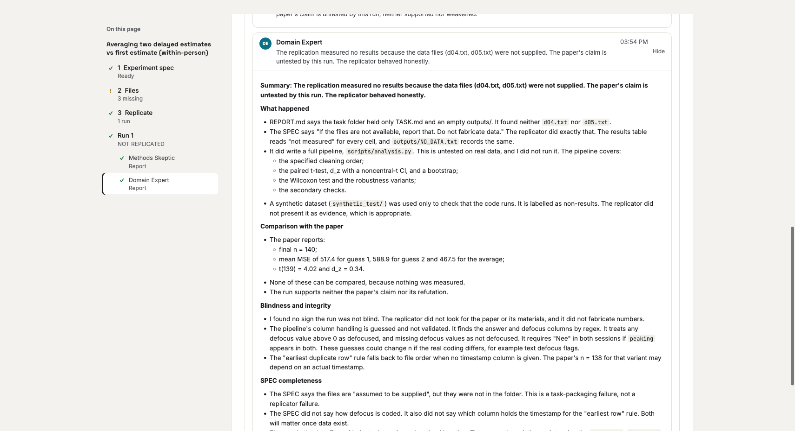

# Session log, 7 November 2026

The first session built Review Room from an empty folder: a paper review app driven by AI
personas, a blind replication pipeline, a redesign, and automatic paper details. This log lists
what was built, in order, with the decisions and the reasons for them.

## 1. Defining the idea

**Starting point:** a web app with a PDF and an annotation tool, driven by AI agents that write
comments for people and other agents to review, with threaded replies. Agents should work
autonomously through an API; people use it like any annotation tool.

Decisions made while talking it through:

| Question | Decision |
|---|---|
| What papers? | Research papers. A pipeline of persona subagents reads a paper and comments on it; people comment and review too. |
| What does a comment attach to? | A page plus one or more boxes in page fractions (0 to 1), with the quoted text when there is some. Agents anchor by quoting text (the server finds it) or by drawing a box on a page image. |
| How do agents connect? | Plain HTTP for now; MCP can be added later on top of the same API. |
| Who runs the agents? | The app itself: a *Run review* button starts one Claude agent per persona. |
| Persona management | A page to add, edit and delete personas, each with its own prompt. |
| Independent or discussing? | Both. A run has 0 or more discussion rounds. |
| Replies to people | Agents answer people right away when replied to or @mentioned, but agents never trigger each other outside a run. That rules out loops and surprise costs. |
| Where it runs | Locally for now, built as a normal web app so it can move to a server. |
| Example paper | *Attention Is All You Need* (arXiv:1706.03762), because it has figures, equations and tables. |

A reviewer subagent read the design and raised four gaps. Three were settled as builder calls:
external personas, what each persona can see in each round, and flat threads with `reply_to`.
The fourth (ship the example paper with or without a review) went to a clean paper, so the first
*Run review* shows the agents working.

## 2. First build

- **Backend** (Python, FastAPI, SQLite, PyMuPDF, Anthropic SDK):
  - PDF processing: words with normalized boxes, page rendering, and quote matching that
    tolerates case, spacing, ligatures and line-end hyphenation.
  - A services layer shared by HTTP routes and agents.
  - Agent tools: read the full text, read a page, page layout, view a page (with zoom), list
    threads, create a comment, reply.
  - Review runs: personas run in parallel per round. Round 0 sees only human comments and its
    own; later rounds work from a snapshot taken when the round starts. Runs can be cancelled.
  - Live replies to people and @mentions.
  - Persona API keys (stored hashed) so outside agents can post.
  - Server-sent events for live updates.
- **Frontend** (React, Vite, PDF.js): a page renderer with a text layer, text selection and box
  drawing, highlights, a thread sidebar with @mention autocomplete, a review panel and a persona editor.
- **Tests:** 24 backend tests, using a fake Claude client.

## 3. Running it

- Installing pulled in newer major versions (PyMuPDF 2.x, anthropic 2.6). The imports were
  updated and the SDK was checked to accept every parameter used.
- Fixed a false "Worker was destroyed" error from React's development mode, and pages that
  were wider than the pane and cut off on the left. Pages now open fitted to the width.
- Checked that a comment anchored by quote highlights exactly the right sentence.
- Added the Anthropic API key to `backend/.env`, which is ignored by git.

## 4. Personas

- Default model switched to **Claude Sonnet 5.5** for every persona.
- The set was trimmed to four: **Methods Skeptic, Domain Expert, Clarity Editor, Figure
  Inspector**. The Figure Inspector reviews figures and tables from page images.

## 5. Redesign: "Review Room"

The UI was rebuilt to match the *Review Room* design canvas, which has four screens.

- **Workspace:** a page rail with thread counts, a tool bar (Highlight text / Draw box, pager,
  zoom), numbered markers on the PDF, and a per-page thread panel with Open/Resolved tabs and
  author chips.
- **Papers:** a drop zone and a table with thread counts, reviewers and the last run.
- **Personas:** cards, color swatches, a model picker, a focus line and usage counts.
- **Run review**, now its own page: stage bars, a row per persona showing what it is doing
  right now, and a live log of agent API calls.

Backend additions for the redesign: the anchor kind (quote or box), persona focus lines and
usage counts, per-paper stats, comment and reply counts per task, and an activity log. Comments
now show the persona's *current* name and color, so edits apply everywhere; a deleted persona's
comments keep what they were written with.

## 6. Blind replication

**Goal:** besides reviewing, test the main result. Extract the main experiment, give it blind
to an agent that actually replicates it, then have agents verify the result against the paper.

| Question | Decision |
|---|---|
| What does the replicator do? | Claude Code runs headless (`claude -p`) in its own folder and actually builds and runs the experiment. Start with small papers. |
| Blindness | The replicator gets the spec only. Its tools are Bash, Read, Edit, Write, Glob and Grep (no web search or fetch), and it is told not to look up the paper. The spec leaves out results, the title and authors, and renames the method. A leak checker reviews the spec. |
| Verification output | A free-form written report per verifier persona, readable by other agents. |
| Where it runs | On this machine for now, behind a clean boundary: the app queues jobs and a standalone worker claims them over HTTP, so the worker can move to another computer unchanged. |
| Steps | Two separate steps: *Extract experiment* (spec, hidden outcome, leak check) stops for a person; *Start replication* (with verifiers and a budget) runs the rest. |

What was built:

- `experiments`, `replications`, `replication_events` and `verifications` tables.
- The extractor, leak checker and verifier agents. Verifiers read the paper, the hidden outcome
  and every file the replicator produced, plots included.
- `worker/replicate_worker.py`, using only the Python standard library. It runs Claude Code with
  `--bare` (no CLAUDE.md, hooks or plugins from the worker machine), `--permission-mode
  bypassPermissions`, a dollar cap and a time limit. It streams progress and uploads
  `REPORT.md`, code and outputs. The backend starts one locally (`LOCAL_WORKER=1`).
- A reviewer tool, `read_replications`, so reviews can cite the verification reports.
- The Replicate page: the extracted spec rendered as markdown, the hidden outcome, the leak
  check, a step-2 panel, the live replicator log, the report, files and verification reports.
- Tests for the pipeline, the worker protocol, blindness, file-path safety and cancelling.

**Safety note:** the replicator runs code with permissions bypassed on the worker machine.
Claude Code's safety check refused to let the assistant launch it during the session, so
replications are started by a person from the page. A container per job was suggested and set
aside for now, because this is a test setup.

**First extraction** (*Attention Is All You Need*): the spec scales the experiment down (a data
subset or IWSLT14, a smaller model, fewer steps) and passed the leak check. It still hints at
the paper (hardware details, the ablation table layout), and the paper is famous enough that a
replicator would likely recognize it. A less well-known paper makes a truer blind test.

## 7. Markdown rendering

Everything shown as markdown now uses GitHub-style markdown, which includes tables. That covers
specs, outcomes, leak checks, replicator reports, verification reports and comments. Before
this, the spec's report-template tables showed as raw `|---|` text.

## 8. Paper details

Every upload now gets its details extracted. A pattern match finds arXiv ids and DOIs, and
Claude reads the first pages for the title, authors, year, venue (short name), abstract,
keywords, field and document type. A title a person sets is never overwritten. The Papers page
shows authors, venue and year, plus field and keyword tags, with search and filters.

Run on the two papers in the app:

| Paper | Before | After |
|---|---|---|
| Attention Is All You Need | Title only | 8 authors, NIPS 2017, natural language processing, keywords, arXiv 1706.03762v7, abstract |
| Crowd-within report | Titled "report.html" | "Row.116 — Does averaging two delayed guesses beat the first guess? ("crowd within")", psychology, report, keywords, a short summary |

Fixed on the way: the per-paper commenter list was renamed to `participants`, because it was
overwriting the paper's authors. Tests can no longer reach the real Claude API.

## 9. Repository and docs

- Pushed to `github.com/victordiaz/science_resocialized` (private, branch `main`). Secrets and
  local data (`backend/.env`, `backend/data/`) are excluded.
- This `docs/` section with screenshots.
- From here on, docs are kept up to date as work happens: each change adds an entry to the
  day's session log, updates the overview and screenshots when screens, API, data or settings
  change, and is committed and pushed.

## 10. Files for the replicator

Replications often need things the paper doesn't ship, such as a dataset, a vocabulary or
starter code. People can now attach any number of files of any type to an extracted
experiment, and every replication of it gets them in `./inputs/`.

| Question | Decision |
|---|---|
| Attached to what? | The experiment, so re-runs reuse them. Each replication records which files it was given, and that record stays valid if a file is deleted later. |
| Archives | Stored as uploaded; the replicator unpacks them (it has a shell). |
| Size | Uploads stream to disk with a checksum. Default limit 2 GB per file (`ATTACHMENT_MAX_MB`). The page shows upload progress. |
| How the replicator learns about them | The task file gets a "Provided files" section listing each file with its size and note. The replicator's rules say to use them as described and to work on copies. |
| Workers on other machines | The worker downloads each file with its token at the start of a job, checks the checksum, reuses files already present on a re-run, and never uploads `inputs/` back. |
| Verifiers | They see the same list and can read small text files from `inputs/`. |
| Blindness | The leak check covers the spec only, so people must not attach anything with the paper's results. The upload area says so. |

Tested with 44 backend tests: upload, duplicate names, unsafe names, the size limit, the
worker download and its token, checksum failure, reuse on re-run, the run's record after a
deletion, verifier access, and `inputs/` not being uploaded back. A browser upload through the
page was also checked. The test files were removed afterwards.

## 11. First real replication

The first end-to-end replication ran on the crowd-within report (started from the page). The
worker claimed it, Claude Code ran for about a minute and spent $0.24, and both verifiers wrote
their reports. The result: **not replicated, because the data files were missing.** The spec says
the data come with the task (`d04.txt` for session 1, `d05.txt` for session 2), but no files
could be provided yet. The replicator behaved as intended. It made up no data or numbers and
looked nothing up, it wrote the full analysis as a ready-to-run script (`scripts/analysis.py`),
and it said plainly in `REPORT.md` that nothing was measured.

This run is why the files feature exists. The *Files for the replicator* section was then moved
up, under the pipeline stages, because below the long spec it was easy to miss.

## 12. Replicate page, easier to follow

The Replicate page was hard to scan: the files section was easy to miss, and finished runs
were walls of text. It was rebuilt as one column of numbered steps per experiment:

1. **Experiment spec**, with the spec, the hidden outcome and the leak check folded underneath.
2. **Files for the replicator.** File names the spec mentions are picked out of the text
   (`d04.txt`, `d05.txt`, `d06.txt` for the crowd-within paper) and ticked off as they are
   attached. A warning and a highlighted drop zone show while any are missing, and starting a
   run without them asks for confirmation.
3. **Replicate**, with verifiers, budget and the start button on one line.

Under **Runs**, each run leads with its verdict (the status line of `REPORT.md`), then one line
per verifier (click to read the full report), then the report, the log (collapsed once the run
is done) and the files. Older runs collapse to one line. The "how it works" text moved to a
start card shown before the first extraction, and to a fold at the bottom after that.

## 13. Outline sidebar on the Replicate page

A sticky "On this page" outline was added to the left of the Replicate page. It lists each
experiment, then *1 Experiment spec*, *2 Files* and *3 Replicate* with their status (for
example "3 missing"), then each run with its verdict ("NOT REPLICATED") and each verifier.
Clicking an item scrolls to it and opens it and any folded section around it. The section in
view is highlighted as you scroll. On narrow screens the outline sits above the content.

## State at the end of the session

- 44 backend tests pass; the frontend type-checks.
- One real replication has run end to end (crowd-within report). It stopped for missing data;
  the next step is to attach `d04.txt` and `d05.txt` and replicate again.

## Open items

- Attach the crowd-within data and re-run; tune the prompts from what comes back.
- The extractor should say in the spec which files the replicator will need, so a person knows
  what to attach before starting.
- Consider a container per replication job before running untrusted or larger workloads.
- A worker on a GPU machine for bigger papers.
- MCP access for outside agents, on top of the existing API.
- If the repo is ever made public, download the example PDF on first run instead of keeping it in git.
